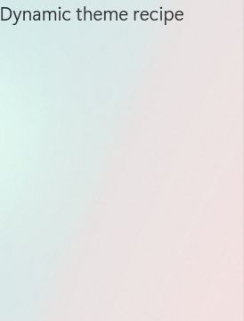
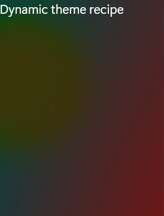

# AcrylicElement

Use `AcrylicElement` to blur a named WPF visual behind content in the same window. The host keeps its text, icons, and controls sharp. Window-level effects such as Mica still use [FluenceWindow](fluence-window.md).

| Light | Dark |
| --- | --- |
|  |  |

## Add acrylic behind content

Apply a Fluence theme before opening the window. Place two overlapping siblings in a `Grid`. Declare the source first, then declare the host above it. Point the host's `BackdropSource` at the sibling by name.

```xml
<Grid xmlns="http://schemas.microsoft.com/winfx/2006/xaml/presentation"
      xmlns:x="http://schemas.microsoft.com/winfx/2006/xaml"
      xmlns:fluence="http://schemas.fluencewpf.com"
      Height="160">
    <Grid x:Name="BackdropSource" Background="DarkSlateBlue">
        <Rectangle Width="120" HorizontalAlignment="Left" Fill="Coral" />
        <Rectangle Width="120" HorizontalAlignment="Right" Fill="MediumAquamarine" />
    </Grid>
    <fluence:AcrylicElement Margin="20" Padding="16"
                            BackdropSource="{Binding ElementName=BackdropSource}"
                            Recipe="{DynamicResource AcrylicInAppDefaultRecipe}">
        <TextBlock Foreground="{DynamicResource TextFillColorPrimaryBrush}"
                   Text="Content stays sharp" />
    </fluence:AcrylicElement>
</Grid>
```

Bind to a [published recipe](../theming.md#acrylic-recipes) through `DynamicResource` to pick up theme changes. Choose `AcrylicInAppAccentDefaultRecipe` or `AcrylicInAppAccentBaseRecipe` for material tinted by the current accent. Omit `Recipe` to use the class defaults.

## Paint a decorative surface

Use `{fluence:AcrylicBrush BackdropSourceName=BackdropSource, Recipe={StaticResource FixedAcrylic}}` for a concrete `Border.Background`, `Rectangle.Fill`, or `Ellipse.Fill`. Define `FixedAcrylic` as an `AcrylicMaterialRecipe` in the same XAML resource scope. The direct extension takes a fixed recipe at the target. Use the host for a recipe that follows changes to a theme resource. [Example with both forms](../controls.md#acrylic-materials)

## Check the solid fallback

Read the host's `IsUsingFallback` to show whether it is painting a solid fill. Set `AlwaysUseFallback="True"` on an application-owned recipe to check the solid treatment. High Contrast uses the system window color. The normal fallback uses the recipe's `FallbackColor`.

If the fallback appears unexpectedly, check that both elements are loaded, overlap, and share a WPF window. Keep the source outside the host's subtree and use translation or positive axis-aligned scaling. A WPF popup has a separate window. Software rendering, disabled Windows transparency effects, and the acrylic pixel budget can also trigger fallback. [Source rules and limits](../controls.md#acrylic-materials)

- [C# API reference](../api/Fluence.Wpf.Controls/AcrylicElement.md)
- [Acrylic example in the Gallery](https://github.com/sintaxasn/Fluence.Wpf/blob/main/Fluence.Wpf.Demo/Pages/GalleryAcrylicPage.xaml)
- [PowerShell Controls Tour](../powershell/controls.md#explore-the-controls-tour)
