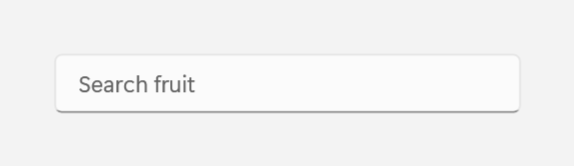
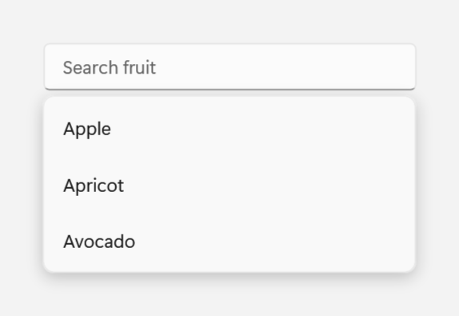
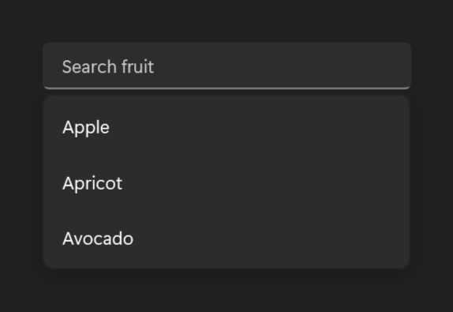

# AutoSuggestBox

## Description

Use AutoSuggestBox for search and autocomplete: handle TextChanged to filter suggestions and QuerySubmitted to act on the choice.

| Light | Dark |
| --- | --- |
|  |  |

### Open suggestions





## Example usage

```xml
<fluence:AutoSuggestBox PlaceholderText="Search" ItemsSource="{Binding Suggestions}" />
```

```csharp
var search = new Fluence.Wpf.Controls.AutoSuggestBox { PlaceholderText = "Search" };
```

## Key properties

| Property | Default | Purpose |
| --- | --- | --- |
| `Text` | Empty string | Current query text. |
| `ItemsSource` | `null` | Suggestion items. |
| `TextMemberPath` | Empty string | Member used as text for a suggestion. |
| `IsSuggestionListOpen` | `false` | Controls suggestion popup state. |
| `UpdateTextOnSelect` | `true` | Updates text when a suggestion is chosen. |
| `MaxSuggestionListHeight` | `374` | Maximum popup height. |

## State and behavior

Handle `TextChanged` to filter `ItemsSource`; the control does not filter the collection automatically. Handle `QuerySubmitted` when the user submits text or chooses a suggestion.

## Additional behavior

`AutoSuggestBox` observes collection changes when its current `ItemsSource` implements `INotifyCollectionChanged`. Adding the first suggestion or removing the last one updates the popup without replacing the collection or the consumer's open-state binding.

## Events

`TextChanged`, `SuggestionChosen`, and `QuerySubmitted` report text changes, chosen items, and submitted queries.

## Related

- [C# how-to guide](../how-to/inputs-and-data.md)

See [text input focus and selection](text-box.md#text-input-focus) for the shared WPF editor behavior.

## Reference

- [C# API reference](../api/Fluence.Wpf.Controls/AutoSuggestBox.md)
- [Gallery XAML source](../../Fluence.Wpf.Demo/Pages/GalleryInputsPage.xaml)
- [Gallery C# source](../../Fluence.Wpf.Demo/Pages/GalleryInputsPage.xaml.cs)
- [Control source](../../Fluence.Wpf/Controls/AutoSuggestBox.cs)
- [Control catalog](../controls.md)
