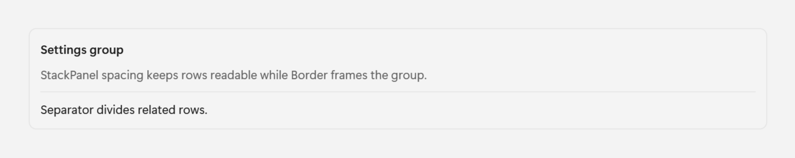
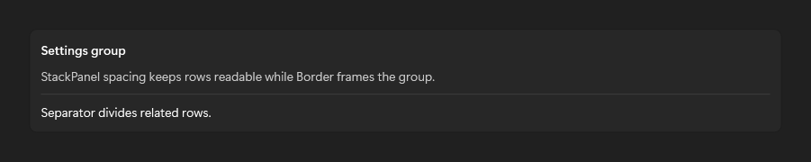

# Border

## Description

Border extends the WPF `Border` with themed surface presets.

| Light | Dark |
| --- | --- |
|  |  |

## Example usage

```xml
<fluence:Border
    BorderBrush="{DynamicResource CardStrokeColorDefaultBrush}"
    BorderThickness="1"
    CornerRadius="8"
    Padding="12">
    <TextBlock Text="Framed content" />
</fluence:Border>
```

```csharp
var border = new Fluence.Wpf.Controls.Border { Padding = new System.Windows.Thickness(12) };
```

## Key properties

| Property | Default | Purpose |
| --- | --- | --- |
| `Variant` | `None` | Choose `Card`, `Subtle`, or `Divider`, or retain `None` for a custom border. |

## State and behavior

BorderBrush, thickness, and corner radius frame content and follow dynamic theme resources.

## Related

- [C# how-to guide](../how-to/inputs-and-data.md)

## Reference

- [C# API reference](../api/Fluence.Wpf.Controls/Border.md)
- [Gallery XAML source](../../Fluence.Wpf.Demo/Pages/GalleryLayoutPage.xaml)
- [Gallery C# source](../../Fluence.Wpf.Demo/Pages/GalleryLayoutPage.xaml.cs)
- [Control source](../../Fluence.Wpf/Controls/Border.cs)
- [Control catalog](../controls.md)
