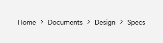
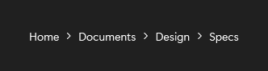
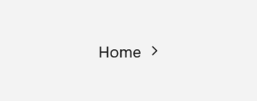
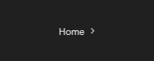

# BreadcrumbBar

## Description

Use BreadcrumbBar to show the path to the current location and jump back to any ancestor.

| Light | Dark |
| --- | --- |
|  |  |

## Example usage

```xml
<fluence:BreadcrumbBar ItemsSource="{Binding PathSegments}" />
```

```csharp
var path = new Fluence.Wpf.Controls.BreadcrumbBar();
path.Items.Add("Home");
```

## Key properties

| Property | Default | Purpose |
| --- | --- | --- |
| `ItemsSource` | `null` (WPF default) | Collection of path segments. |
| `ItemTemplate` | `null` (WPF default) | Template for each segment. |

## State and behavior

The current path is displayed as clickable ancestors; ItemClicked identifies a navigation target.

## Parts

### BreadcrumbBarItem {#breadcrumb-bar-item}

#### Description {#breadcrumb-bar-item-description}

BreadcrumbBar creates item containers for the visible path segments. The screenshots show `BreadcrumbBarItem` inside `BreadcrumbBar`.

Use it through BreadcrumbBar when people need to return to an ancestor location.

| Light | Dark |
| --- | --- |
|  |  |

#### Example usage {#breadcrumb-bar-item-example-usage}

```xml
<fluence:BreadcrumbBar ItemsSource="{Binding PathSegments}" />
```

#### State and behavior {#breadcrumb-bar-item-state-and-behavior}

A breadcrumb item is created inside BreadcrumbBar from the path; selecting an ancestor raises ItemClicked.

#### Reference {#breadcrumb-bar-item-reference}

- [C# API reference](../api/Fluence.Wpf.Controls/BreadcrumbBarItem.md)
- [Gallery XAML source](../../Fluence.Wpf.Demo/Pages/GalleryNavigationPage.xaml)
- [Gallery C# source](../../Fluence.Wpf.Demo/Pages/GalleryNavigationPage.xaml.cs)
- [Control source](../../Fluence.Wpf/Controls/BreadcrumbBarItem.cs)
- [Control catalog](../controls.md)

## Events

`ItemClicked` reports the chosen segment.

## Related

- [C# how-to guide](../how-to/navigation-and-tabs.md)

## Reference

- [C# API reference](../api/Fluence.Wpf.Controls/BreadcrumbBar.md)
- [Gallery XAML source](../../Fluence.Wpf.Demo/Pages/GalleryNavigationPage.xaml)
- [Gallery C# source](../../Fluence.Wpf.Demo/Pages/GalleryNavigationPage.xaml.cs)
- [Control source](../../Fluence.Wpf/Controls/BreadcrumbBar.cs)
- [Control catalog](../controls.md)
