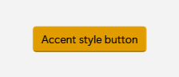
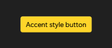
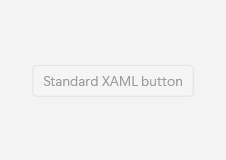
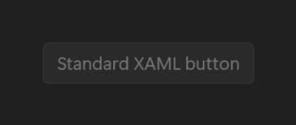
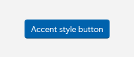
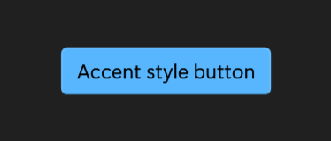
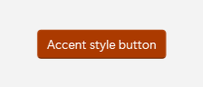
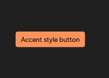

# Button

## Description

Use Button for actions. Choose its Accent appearance for the primary action and Subtle for a less prominent command.

| Light | Dark |
| --- | --- |
|  |  |

### Disabled state {#captured-state-changes}




### Blue accent




### Orange accent




## Example usage

```xml
<fluence:Button Content="Accent style button" Appearance="Accent" />
```

```csharp
var button = new Fluence.Wpf.Controls.Button
{
    Content = "Save",
    Appearance = Fluence.Wpf.ControlAppearance.Accent,
};
```

## Key properties

| Property | Default | Purpose |
| --- | --- | --- |
| `Appearance` | `Standard` | Selects the button emphasis. |
| `Icon` | `null` | Optional icon content. |
| `IconPlacement` | `Left` | Places the icon relative to the label. |
| `CornerRadius` | `4` | Rounds the button surface. |

## State and behavior

When string content is truncated, Button can show the full text in an automatic tooltip. A tooltip supplied by the application takes precedence.

Appearance changes emphasis. Pointer-over, pressed, keyboard focus, and disabled states change the surface.

## Additional behavior

`ControlAppearance` selects the visual emphasis for supported controls. The gallery's Buttons and Selection pages show the variants. For a primary command, `Appearance="Accent"` is the common choice.

## Events

The inherited `Click` event reports activation.

## Related

- [C# how-to guide](../how-to/inputs-and-data.md)

## Reference

- [C# API reference](../api/Fluence.Wpf.Controls/Button.md)
- [Gallery XAML source](../../Fluence.Wpf.Demo/Pages/GalleryButtonsPage.xaml)
- [Gallery C# source](../../Fluence.Wpf.Demo/Pages/GalleryButtonsPage.xaml.cs)
- [Control source](../../Fluence.Wpf/Controls/Button.cs)
- [Control catalog](../controls.md)
