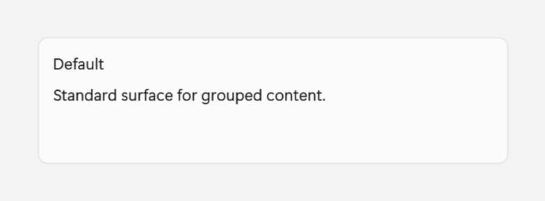
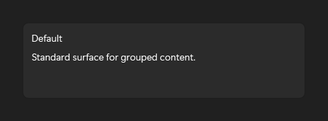

# Card

## Description

Use Card variants to group related data with different levels of visual emphasis.

| Light | Dark |
| --- | --- |
|  |  |

## Example usage

```xml
<fluence:Card Header="Account" Content="Profile details" IsClickable="True" />
```

```csharp
var card = new Fluence.Wpf.Controls.Card { Header = "Account", Content = "Profile details" };
```

## Key properties

| Property | Default | Purpose |
| --- | --- | --- |
| `Variant` | `Default` | Selects the card surface variant. |
| `Header` | `null` | Content displayed above the card body. |
| `Footer` | `null` | Content displayed below the card body. |
| `IsClickable` | `false` | Enables card activation. |
| `CornerRadius` | `8` | Rounds the card surface. |

## State and behavior

Cards may be passive or clickable; clickable cards expose pointer, focus, and pressed states.

## Events

`Click` reports activation when the card is clickable.

## Related

- [C# how-to guide](../how-to/inputs-and-data.md)

## Reference

- [C# API reference](../api/Fluence.Wpf.Controls/Card.md)
- [Gallery XAML source](../../Fluence.Wpf.Demo/Pages/GalleryDataPage.xaml)
- [Gallery C# source](../../Fluence.Wpf.Demo/Pages/GalleryDataPage.xaml.cs)
- [Control source](../../Fluence.Wpf/Controls/Card.cs)
- [Control catalog](../controls.md)
