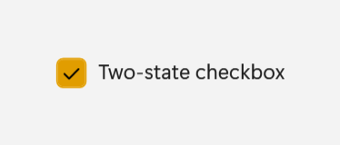
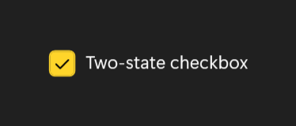

# CheckBox

## Description

Use check boxes for independent options. Add three-state only when an indeterminate value has meaning.

| Light | Dark |
| --- | --- |
|  |  |

## Example usage

```xml
<fluence:CheckBox Content="Two-state checkbox" IsChecked="True" />
```

```csharp
var option = new Fluence.Wpf.Controls.CheckBox { Content = "Enable", IsChecked = true };
```

## Key properties

| Property | Default | Purpose |
| --- | --- | --- |
| `IsChecked` | `false` (WPF default) | Check state; can be indeterminate when three-state behavior is enabled. |
| `IsThreeState` | `false` (WPF default) | Allows an indeterminate state. |
| `Description` | `null` | Supporting text for the option. |
| `CornerRadius` | `4` | Rounds the indicator. |

## State and behavior

IsChecked shows unchecked and checked states, with indeterminate available when IsThreeState is enabled.

In High Contrast, the indeterminate plate and dash use their own normal, hover, pressed, and disabled resources, distinct from the checked mark. The [theme resource guide](../theming.md#high-contrast-roles) lists the published keys and their Windows color roles.

## Additional behavior

The `CheckBox` keeps native WPF selection, input, and automation behavior. Its indicator is a 20-DIP box with a 1-DIP outline. The animated check path uses a source-derived 1.225-DIP stroke; checking draws it over 316.7 ms in normal and hover states, while pressing from unchecked draws it over 150 ms. Unchecking erases the path over 66.7 ms. The indeterminate dash remains static. State changes use a bounded FIFO route queue and coalesce changes received before layout. Initial load and retemplating snap to the current glyph; unloading cancels active motion and clears queued routes. Disabled motion also snaps to the resolved state. The animation uses path trim only, without fade or scale effects. The check geometry and route data are adapted from Microsoft WinUI's [`AnimatedAcceptVisualSource`](https://github.com/microsoft/microsoft-ui-xaml/blob/7b12709347527238494ca28cb9fed326d513e779/controls/dev/AnimatedIcon/AnimatedVisuals/AnimatedAcceptVisualSource.cpp) and [`CheckBox` theme resources](https://github.com/microsoft/microsoft-ui-xaml/blob/7b12709347527238494ca28cb9fed326d513e779/controls/dev/CommonStyles/CheckBox_themeresources.xaml), under the upstream repository's [MIT license](https://github.com/microsoft/microsoft-ui-xaml/blob/7b12709347527238494ca28cb9fed326d513e779/LICENSE).

### Theme resource roles

CheckBox publishes separate `CheckBoxCheckBackgroundFillIndeterminate*` plate and `CheckBoxCheckGlyphForegroundIndeterminate*` dash families. Each has base, `PointerOver`, `Pressed`, and `Disabled` color keys with brush twins. In High Contrast, the plate uses Highlight, HighlightText, Highlight, and GrayText in that order; the dash uses HighlightText, Highlight, HighlightText, and Window. In Light and Dark, these roles use the same accent and on-accent values as the corresponding checked states. Custom templates should use the indeterminate keys when the high-contrast distinction matters.

`CheckBoxCheckBackgroundStrokeIndeterminatePointerOver` and its `Brush` twin give the indeterminate hover outline its own semantic role. Light and Dark resolve it to `AccentFillSecondary`; High Contrast resolves it to `Highlight`, while the indeterminate fill remains `HighlightText`.

## Events

The inherited `Checked`, `Unchecked`, and `Indeterminate` events report check-state changes.

## Related

- [C# how-to guide](../how-to/inputs-and-data.md)

## Reference

- [C# API reference](../api/Fluence.Wpf.Controls/CheckBox.md)
- [Gallery XAML source](../../Fluence.Wpf.Demo/Pages/GallerySelectionPage.xaml)
- [Gallery C# source](../../Fluence.Wpf.Demo/Pages/GallerySelectionPage.xaml.cs)
- [Control source](../../Fluence.Wpf/Controls/CheckBox.cs)
- [Control catalog](../controls.md)
