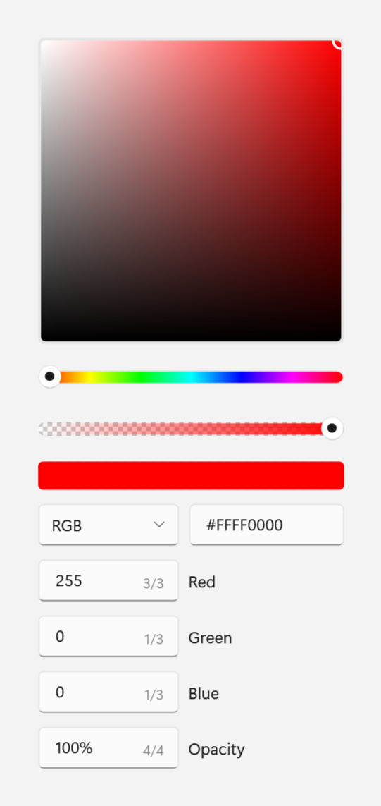
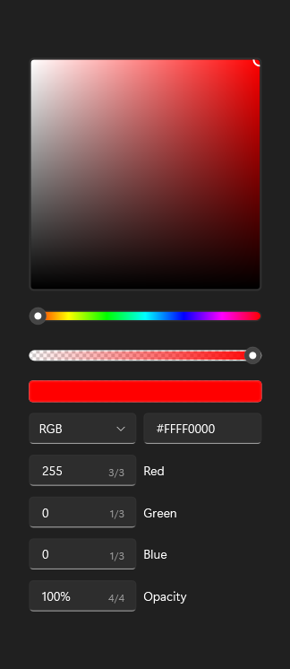

# ColorPicker

## Description

Use ColorPicker for choosing a color from a saturation/value spectrum with a hue slider, alpha, RGB/HSV channel text input, and hex input.

| Light | Dark |
| --- | --- |
|  |  |

## Example usage

```xml
<fluence:ColorPicker Color="Red" />
```

```csharp
var picker = new Fluence.Wpf.Controls.ColorPicker { Color = System.Windows.Media.Colors.Red };
```

## Key properties

| Property | Default | Purpose |
| --- | --- | --- |
| `Color` | `Red` | Current color. |
| `PreviousColor` | `null` | Optional previous color for comparison. |
| `IsAlphaEnabled` | `false` | Enables alpha editing. |
| `IsColorSpectrumVisible` | `true` | Shows the color spectrum. |
| `IsHexInputVisible` | `true` | Shows the hexadecimal field. |

## State and behavior

Spectrum, hue, alpha, channel, and hex input update Color and raise ColorChanged.

## Additional behavior

ColorPicker's Hex field omits the character counter while retaining its RGB/ARGB input-length limit. Its RGB, HSV, and alpha fields keep their existing counters.

## Events

`ColorChanged` reports a change to the selected color.

## Related

- [C# how-to guide](../how-to/inputs-and-data.md)

See [text input focus and selection](text-box.md#text-input-focus) for the shared WPF editor behavior.

## Reference

- [C# API reference](../api/Fluence.Wpf.Controls/ColorPicker.md)
- [Gallery XAML source](../../Fluence.Wpf.Demo/Pages/GalleryFormsPage.xaml)
- [Gallery C# source](../../Fluence.Wpf.Demo/Pages/GalleryFormsPage.xaml.cs)
- [Control source](../../Fluence.Wpf/Controls/ColorPicker.cs)
- [Control catalog](../controls.md)
