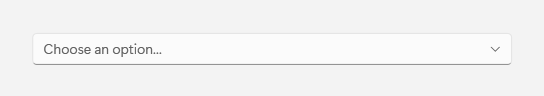
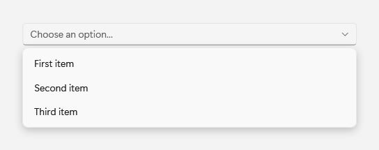
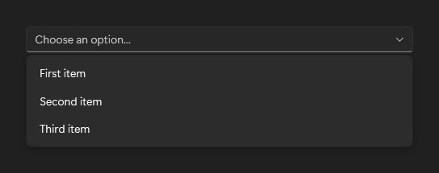

# ComboBox

## Description

Use a combo box when the choices are useful but do not need to stay visible.

| Light | Dark |
| --- | --- |
|  |  |

### Open list





## Example usage

```xml
<fluence:ComboBox PlaceholderText="Choose an option..." SelectedIndex="-1">
    <ComboBoxItem Content="First item" />
    <ComboBoxItem Content="Second item" />
</fluence:ComboBox>
```

```csharp
var options = new Fluence.Wpf.Controls.ComboBox { PlaceholderText = "Choose an option" };
options.Items.Add("First");
```

## Key properties

| Property | Default | Purpose |
| --- | --- | --- |
| `PlaceholderText` | `null` | Text displayed when no item is selected. |
| `Icon` | `null` | Optional icon content. |
| `CornerRadius` | `4` | Rounds the field. |
| `DropdownCornerRadius` | `8` | Rounds the drop-down surface. |
| `DisplayMemberPath` | Empty string (WPF default) | Member used to display object-backed items. |

## State and behavior

Opening the list reveals choices; selection updates SelectedItem and the collapsed label.

## Additional behavior

For object-backed items, `DisplayMemberPath` specifies the member shown for the selected value when the ComboBox is closed.

## Events

The inherited `SelectionChanged` event reports a changed selection.

## Related

- [C# how-to guide](../how-to/inputs-and-data.md)

## Platform behavior

### Editable selection

`ComboBox.IsEditable=True` uses the native WPF text editor. Text, text search, selection, read-only mode, and keyboard behavior follow WPF ComboBox.

### ComboBox pointer press

The closed ComboBox paints a transient pressed fill and border while its nested toggle is pressed. Focused presses keep the focused text and chevron roles, and editable focus keeps its underline. WPF retains click-on-release, typing, text search, and selection behavior.

See [text input focus and selection](text-box.md#text-input-focus) for the shared WPF editor behavior.

## Reference

- [C# API reference](../api/Fluence.Wpf.Controls/ComboBox.md)
- [Gallery XAML source](../../Fluence.Wpf.Demo/Pages/GallerySelectionPage.xaml)
- [Gallery C# source](../../Fluence.Wpf.Demo/Pages/GallerySelectionPage.xaml.cs)
- [Control source](../../Fluence.Wpf/Controls/ComboBox.cs)
- [Control catalog](../controls.md)
