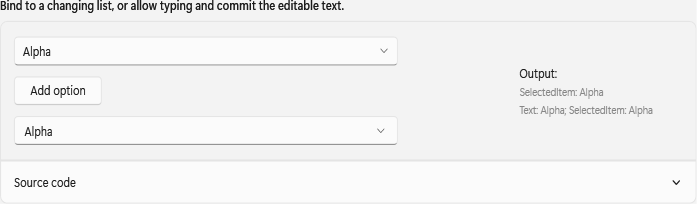
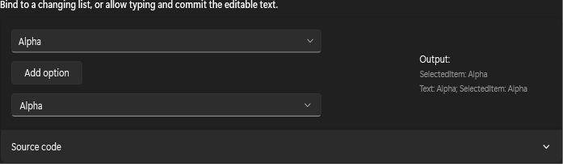

# ComboBox

## Description

Use a combo box when the choices are useful but do not need to stay visible.

| Light | Dark |
| --- | --- |
|  |  |

## Example usage

```xml
<fluence:ComboBox PlaceholderText="Choose an option..." SelectedIndex="-1">
    <ComboBoxItem Content="First item" />
    <ComboBoxItem Content="Second item" />
</fluence:ComboBox>
```

## State and behavior

Opening the list reveals choices; selection updates `SelectedItem` and the collapsed label. The closed control paints a transient pressed state while its nested toggle is pressed. Focused presses retain the focused text and chevron roles, and the editable focus stroke stays in place. WPF continues to own click-on-release, typing, text search, and selection behavior.

## ItemsSource and editable text

Set `ItemsSource` to a collection when the choices come from data. An `ObservableCollection<string>` makes added options appear in the list as the collection changes. Set `IsEditable` to `True` when users may type as well as choose. Read `Text` for entered text and `SelectedItem` for the selected list item; when a user enters free text, those values can differ.

```xml
<StackPanel>
    <fluence:ComboBox
        x:Name="ItemsSourceDemoCombo"
        PlaceholderText="Choose from a changing list" />
    <fluence:Button
        Click="AddComboBoxOptionButton_Click"
        Content="Add option" />
    <fluence:ComboBox
        x:Name="EditableDemoCombo"
        IsEditable="True"
        PlaceholderText="Type or select a value" />
</StackPanel>
```

In the page's code-behind, initialize both controls from the collection and add an option on demand:

```csharp
using System.Collections.ObjectModel;
using System.Windows;
using System.Windows.Controls;

public partial class ComboBoxPage : UserControl
{
    private readonly ObservableCollection<string> _options = new() { "Alpha", "Beta", "Gamma" };
    private int _addedOptionCount;

    public ComboBoxPage()
    {
        InitializeComponent();
        ItemsSourceDemoCombo.ItemsSource = _options;
        EditableDemoCombo.ItemsSource = _options;
    }

    private void AddComboBoxOptionButton_Click(object sender, RoutedEventArgs e)
    {
        _addedOptionCount++;
        _options.Add($"Option {_addedOptionCount}");
    }
}
```

| Light | Dark |
| --- | --- |
|  |  |

The Selection gallery also displays the `SelectedItem` output for the collection-backed control, and both `Text` and `SelectedItem` for the editable control. Its example commits the displayed editable state after a list selection, Enter, dropdown close, or focus leaving the editor.

## Reference

- [C# API reference](../api/Fluence.Wpf.Controls/ComboBox.md)
- [Gallery XAML source](https://github.com/sintaxasn/Fluence.Wpf/blob/main/Fluence.Wpf.Demo/Pages/GallerySelectionPage.xaml)
- [Gallery C# source](https://github.com/sintaxasn/Fluence.Wpf/blob/main/Fluence.Wpf.Demo/Pages/GallerySelectionPage.xaml.cs)
- [Control source](https://github.com/sintaxasn/Fluence.Wpf/blob/main/Fluence.Wpf/Controls/ComboBox.cs)
- [Control catalog](../controls.md)
