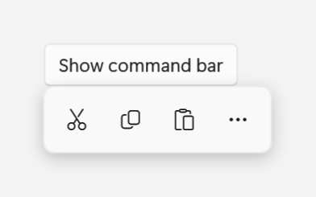
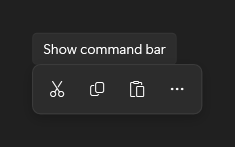
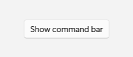
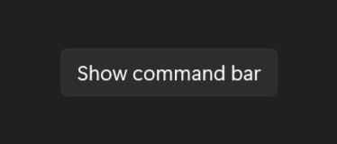
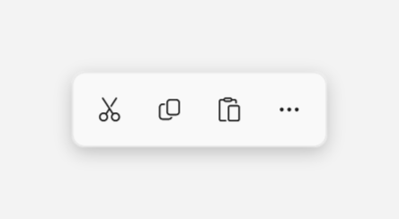
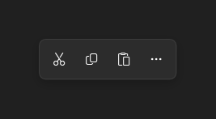

# CommandBarFlyout

## Description

Use CommandBarFlyout for a compact command strip with an overflow menu; commands dismiss the flyout when invoked.

The first images show the open command surface. The closed-state images below show its trigger button.

| Light | Dark |
| --- | --- |
|  |  |

### Captured state changes

**Closed trigger**




## Example usage

```xml
<fluence:Button Content="Commands" Click="ShowFlyoutButton_Click">
    <fluence:FlyoutBase.AttachedFlyout>
        <fluence:CommandBarFlyout>
            <fluence:CommandBarFlyout.PrimaryCommands>
                <fluence:AppBarButton Label="Copy" Command="{Binding CopyCommand}" />
            </fluence:CommandBarFlyout.PrimaryCommands>
            <fluence:CommandBarFlyout.SecondaryCommands>
                <fluence:AppBarButton Label="Delete" Command="{Binding DeleteCommand}" />
            </fluence:CommandBarFlyout.SecondaryCommands>
        </fluence:CommandBarFlyout>
    </fluence:FlyoutBase.AttachedFlyout>
</fluence:Button>
```

In the window or page code-behind:

```csharp
private void ShowFlyoutButton_Click(object sender, System.Windows.RoutedEventArgs e)
{
    if (sender is System.Windows.FrameworkElement target)
    {
        Fluence.Wpf.Controls.FlyoutBase.ShowAttachedFlyout(target);
    }
}
```

Bind `CopyCommand` and `DeleteCommand` on the page's data context.

## Key properties

| Property | Default | Purpose |
| --- | --- | --- |
| `PrimaryCommands` | Empty collection | Commands shown in the primary area. |
| `SecondaryCommands` | Empty collection | Commands shown in the secondary area. |
| `Placement` | `Top` | Positions the flyout relative to its target. |
| `ShouldConstrainToRootBounds` | `true` | Accepted for WinUI API compatibility; WPF popup placement does not enforce this value. |

## State and behavior

Primary commands appear on the strip; secondary commands appear in overflow.

## Parts

### CommandBarFlyoutPresenter {#command-bar-flyout-presenter}

#### Description {#command-bar-flyout-presenter-description}

CommandBarFlyoutPresenter draws the primary strip and overflow surface of CommandBarFlyout. The screenshots show `CommandBarFlyoutPresenter` inside `CommandBarFlyout`.

Use it through CommandBarFlyout when a command strip needs an overflow surface.

| Light | Dark |
| --- | --- |
|  |  |

#### Example usage {#command-bar-flyout-presenter-example-usage}

```xml
<fluence:Button Content="Commands" Click="ShowFlyoutButton_Click">
    <fluence:FlyoutBase.AttachedFlyout>
        <fluence:CommandBarFlyout>
            <fluence:CommandBarFlyout.PrimaryCommands>
                <fluence:AppBarButton Label="Copy" Command="{Binding CopyCommand}" />
            </fluence:CommandBarFlyout.PrimaryCommands>
            <fluence:CommandBarFlyout.SecondaryCommands>
                <fluence:AppBarButton Label="Delete" Command="{Binding DeleteCommand}" />
            </fluence:CommandBarFlyout.SecondaryCommands>
        </fluence:CommandBarFlyout>
    </fluence:FlyoutBase.AttachedFlyout>
</fluence:Button>
```

In the window or page code-behind:

```csharp
private void ShowFlyoutButton_Click(object sender, System.Windows.RoutedEventArgs e)
{
    if (sender is System.Windows.FrameworkElement target)
    {
        Fluence.Wpf.Controls.FlyoutBase.ShowAttachedFlyout(target);
    }
}
```

Bind `CopyCommand` and `DeleteCommand` on the page's data context.

#### State and behavior {#command-bar-flyout-presenter-state-and-behavior}

The presenter displays command bar content and switches between collapsed and expanded overflow states.

#### Reference {#command-bar-flyout-presenter-reference}

- [C# API reference](../api/Fluence.Wpf.Controls/CommandBarFlyoutPresenter.md)
- [Gallery XAML source](../../Fluence.Wpf.Demo/Pages/GalleryMenusPage.xaml)
- [Gallery C# source](../../Fluence.Wpf.Demo/Pages/GalleryMenusPage.xaml.cs)
- [Control source](../../Fluence.Wpf/Controls/CommandBarFlyoutPresenter.cs)
- [Control catalog](../controls.md)

## Events

`Opening` and `Opened` report opening. `Hide()` raises `Closing`, which can be canceled, followed by `Closed` when the popup closes. The light-dismiss handlers call `Hide()`.

## Related

- [C# how-to guide](../how-to/dialogs-and-feedback.md)

## Reference

- [C# API reference](../api/Fluence.Wpf.Controls/CommandBarFlyout.md)
- [Gallery XAML source](../../Fluence.Wpf.Demo/Pages/GalleryMenusPage.xaml)
- [Gallery C# source](../../Fluence.Wpf.Demo/Pages/GalleryMenusPage.xaml.cs)
- [Control source](../../Fluence.Wpf/Controls/CommandBarFlyout.cs)
- [Control catalog](../controls.md)
