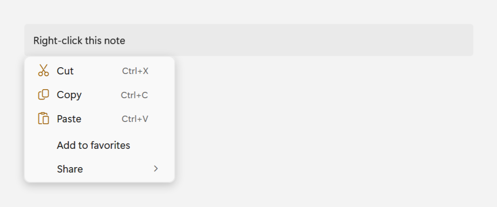
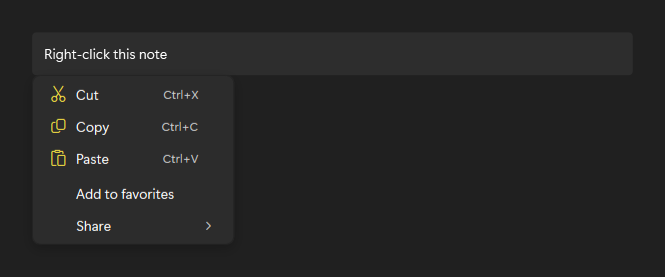

# ContextMenu

## Description

Use ContextMenu for actions that apply to a selected item or region.

The images show the open menu. A closed context menu has no visible surface.

| Light | Dark |
| --- | --- |
|  |  |

## Example usage

```xml
<fluence:Button Content="Open context menu">
    <fluence:Button.ContextMenu>
        <fluence:ContextMenu>
            <fluence:MenuItem Header="Copy" />
        </fluence:ContextMenu>
    </fluence:Button.ContextMenu>
</fluence:Button>
```

```csharp
var menu = new Fluence.Wpf.Controls.ContextMenu();
menu.Items.Add(new Fluence.Wpf.Controls.MenuItem { Header = "Open" });
```

## Key properties

| Property | Default | Purpose |
| --- | --- | --- |
| `Items` | Empty collection (WPF default) | Menu items displayed in the popup. |
| `IsOpen` | `false` (WPF default) | Controls whether the menu is open. |
| `PlacementTarget` | `null` (WPF default) | Element used to position the popup. |

## State and behavior

The menu opens at the target and closes after a command or light dismissal.

## Events

The inherited `Opened` and `Closed` events report popup state changes.

## Related

- [C# how-to guide](../how-to/dialogs-and-feedback.md)

## Reference

- [C# API reference](../api/Fluence.Wpf.Controls/ContextMenu.md)
- [Gallery XAML source](../../Fluence.Wpf.Demo/Pages/GalleryMenusPage.xaml)
- [Gallery C# source](../../Fluence.Wpf.Demo/Pages/GalleryMenusPage.xaml.cs)
- [Control source](../../Fluence.Wpf/Controls/ContextMenu.cs)
- [Control catalog](../controls.md)
