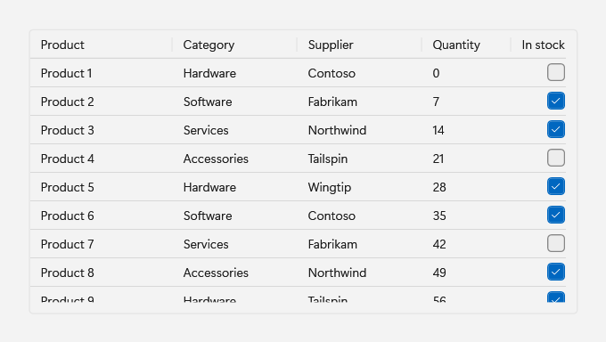
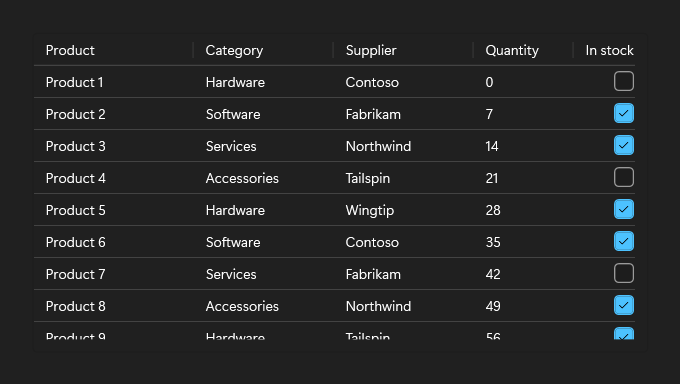

# DataGrid

## Description

DataGrid extends the WPF `DataGrid` with Fluent row, cell, header, and group styles. It is the Fluence counterpart of the WinUI 3 `TableView` and keeps the WPF API names, so native columns, sorting, resizing, reordering, frozen leading columns, editing transactions, validation, grouping, filtering, and row virtualization work as they do in WPF.

Use it for tables of bound data that people sort, group, filter, or edit.

| Light | Dark |
| --- | --- |
|  |  |

## Example usage

Declare the columns and bind each one to a property of the row objects. A header click sorts by that column, a header edge resizes it, and `FrozenColumnCount` keeps the leading columns in place while the grid scrolls sideways.

```xml
<fluence:DataGrid
    x:Name="ProductsGrid"
    Height="320"
    AutoGenerateColumns="False"
    FrozenColumnCount="1"
    IsReadOnly="True">
    <fluence:DataGrid.Columns>
        <DataGridTextColumn Width="160" Binding="{Binding Name}" Header="Product" />
        <DataGridTextColumn Width="140" Binding="{Binding Category}" Header="Category" />
        <DataGridTextColumn Width="100" Binding="{Binding Quantity}" Header="Quantity" />
        <DataGridCheckBoxColumn Width="100" Binding="{Binding InStock}" Header="In stock" />
    </fluence:DataGrid.Columns>
</fluence:DataGrid>
```

```csharp
// Product is an application class with Name, Category, Quantity, and InStock properties.
ProductsGrid.ItemsSource = new ObservableCollection<Product>
{
    new Product { Name = "Laptop", Category = "Hardware", Quantity = 12, InStock = true },
    new Product { Name = "Support plan", Category = "Services", Quantity = 0, InStock = false },
};
```

## Key properties

| Property | Default | Purpose |
| --- | --- | --- |
| `IsItemSelectable` | `true` | Allows row and cell selection. `false` is the equivalent of WinUI `SelectionMode="None"`. |
| `EmptyContent` | `null` | Content shown over the grid while it has no rows. |
| `CornerRadius` | `4` (`ControlCornerRadius`) | Rounds the grid's outer border. |
| `GridLinesVisibility` | `Horizontal` | Inherited; the Fluent style shows horizontal lines only. |
| `HeadersVisibility` | `Column` | Inherited; the Fluent style hides row headers. |
| `FrozenColumnCount` | `0` | Inherited; keeps leading columns in view while scrolling sideways. |

## State and behavior

### Columns and sorting

`DataGridTextColumn` and `DataGridCheckBoxColumn` columns that do not set an `ElementStyle` or `EditingElementStyle` receive the Fluent display and editing styles, so a column that sets its own style keeps it. Use `DataGridTemplateColumn` for other content, and set `SortMemberPath` so a header click can still sort it:

```xml
<DataGridTemplateColumn Width="Auto" Header="Rating" SortMemberPath="Rating">
    <DataGridTemplateColumn.CellTemplate>
        <DataTemplate>
            <fluence:RatingControl VerticalAlignment="Center" IsReadOnly="True" Value="{Binding Rating}" />
        </DataTemplate>
    </DataGridTemplateColumn.CellTemplate>
</DataGridTemplateColumn>
```

`DataGridComboBoxColumn` and `DataGridHyperlinkColumn` have no Fluent styles. For a Fluent drop-down cell, use a `DataGridTemplateColumn` with a Fluence `ComboBox`. Only leading columns can be frozen; trailing frozen columns and the WinUI `Density` option are not provided.

### Grouping and filtering

Group and filter rows through an `ICollectionView`. When the grid loads with an empty `GroupStyle`, it adds a group style with a Fluent collapsible header. `ExpandAllGroups` and `CollapseAllGroups` open or close every realized header of this grid that uses the Fluent header; groups in a grid nested in a cell or the row details are left as they are.

```csharp
var view = new ListCollectionView(products);
view.GroupDescriptions.Add(new PropertyGroupDescription(nameof(Product.Category)));
GroupedGrid.ItemsSource = view;

// Call from a search box's TextChanged handler.
void ApplyFilter(string filterText) =>
    view.Filter = filterText.Length == 0
        ? null
        : item => ((Product)item).Name.IndexOf(filterText, StringComparison.OrdinalIgnoreCase) >= 0;

// Call from an Expand all or Collapse all button.
GroupedGrid.ExpandAllGroups();
GroupedGrid.CollapseAllGroups();
```

Set an application group style before the grid loads, usually in XAML. A group style added later applies only to the second grouping level and below, because the Fluent header already holds the first slot.

As in native WPF, grouping turns off row virtualization unless `VirtualizingPanel.IsVirtualizingWhenGrouping` is set, so a large grouped source realizes every row. Opt in for large sources:

```xml
<fluence:DataGrid
    x:Name="GroupedGrid"
    AutoGenerateColumns="False"
    VirtualizingPanel.IsVirtualizingWhenGrouping="True" />
```

### Editing and validation

When `IsReadOnly` is `false`, a double-click, F2, or typing begins editing a cell; Enter commits and Esc cancels. Bind the grid to row objects that implement `INotifyDataErrorInfo`: an invalid value shows the Fluent error outline with the error message as its tooltip, and the row shows an error indicator. A failed commit keeps the editor open. Handle `CellEditEnding` and `RowEditEnding` to react to committed or cancelled edits.

```xml
<fluence:DataGrid
    x:Name="EditableGrid"
    AutoGenerateColumns="False"
    CanUserAddRows="False"
    CellEditEnding="EditableGrid_CellEditEnding"
    RowEditEnding="EditableGrid_RowEditEnding">
    <fluence:DataGrid.EmptyContent>
        <TextBlock Foreground="{DynamicResource TextFillColorSecondaryBrush}" Text="No products." />
    </fluence:DataGrid.EmptyContent>
    <fluence:DataGrid.Columns>
        <DataGridTextColumn Width="2*" Binding="{Binding Name}" Header="Product" />
        <DataGridTextColumn Width="*" Binding="{Binding Quantity}" Header="Quantity" />
        <DataGridCheckBoxColumn Width="*" Binding="{Binding InStock}" Header="In stock" />
    </fluence:DataGrid.Columns>
</fluence:DataGrid>
```

### Empty state

`EmptyContent` appears over the grid while it has no rows. On an editable source, set `CanUserAddRows` to `false`; otherwise the new-item row counts as a row and the empty content stays hidden.

### Selection

Setting `IsItemSelectable` to `false` clears the selection and suppresses the hover and selection visuals. Cells stay focusable, so keyboard navigation works, and F2 or typing still begins editing. A mouse click does not begin editing, because the native cell starts a click edit only when it is selected. A click briefly selects the row or cell and then clears it, so `SelectedCellsChanged`, and `SelectionChanged` when whole rows are selected, report a selection and then its removal. With row selection, a two-way `SelectedItem` binding sees a transient value.

### Grid lines across theme changes

A frozen `SolidColorBrush` assigned to `HorizontalGridLinesBrush` or `VerticalGridLinesBrush` reads back as a grid-owned copy with the same color. This keeps an open cell edit when the theme or accent changes.

## Events

Use the inherited WPF events: `SelectionChanged` and `SelectedCellsChanged` report selection, `Sorting` reports a header sort, and `CellEditEnding` and `RowEditEnding` report the end of an edit.

## Styling

The Fluent styles are keyed resources, so a native WPF `DataGrid` keeps its own look; the Fluence `DataGrid` style applies them. After `ApplicationThemeManager.Apply`, base a custom style on a key, for example `<Style TargetType="DataGridCell" BasedOn="{StaticResource DataGridCellStyle}">`, and assign it to the matching grid or column property.

| Key | Target | Used for |
| --- | --- | --- |
| `DataGridCellStyle` | `DataGridCell` | `CellStyle` |
| `DataGridRowStyle` | `DataGridRow` | `RowStyle` |
| `DataGridColumnHeaderStyle` | `DataGridColumnHeader` | `ColumnHeaderStyle` |
| `DataGridColumnHeadersPresenterStyle` | `DataGridColumnHeadersPresenter` | The column header row |
| `DataGridColumnHeaderGripperStyle` | `Thumb` | Column header resize gripper |
| `DataGridRowHeaderStyle` | `DataGridRowHeader` | `RowHeaderStyle` |
| `DataGridRowHeaderGripperStyle` | `Thumb` | Row header resize gripper |
| `DataGridSelectAllButtonStyle` | `Button` | Select-all corner, visible when `HeadersVisibility` is `All` |
| `DataGridValidationErrorTemplate` | Control template | Validation outline for cell text |
| `DataGridTextColumnElementStyle` | `TextBlock` | Text column display element |
| `DataGridTextColumnEditingElementStyle` | `TextBox` | Text column editor |
| `DataGridCheckBoxTemplate` | `CheckBox` template | Compact check box in check box columns |
| `DataGridCheckBoxColumnElementStyle` | `CheckBox` | Check box column display element |
| `DataGridCheckBoxColumnEditingElementStyle` | `CheckBox` | Check box column editor |
| `DataGridGroupItemStyle` | `GroupItem` | Fluent collapsible group header |

## Related

- [WinUI parity and differences](../winui-parity.md#differences-to-account-for)
- [Known issues: native grid behavior](../../KNOWN_ISSUES.md#current-follow-ups-not-defects)
- [Bind PowerShell objects to a DataGrid](../powershell/how-to/windows-from-xaml.md#bind-powershell-objects-to-a-datagrid)

## Reference

- [C# API reference](../api/Fluence.Wpf.Controls/DataGrid.md)
- [Gallery XAML source](../../Fluence.Wpf.Demo/Pages/GalleryDataGridPage.xaml)
- [Gallery C# source](../../Fluence.Wpf.Demo/Pages/GalleryDataGridPage.xaml.cs)
- [Control source](../../Fluence.Wpf/Controls/DataGrid.cs)
- [Theme resources](../../Fluence.Wpf/Themes/Controls/DataGrid.xaml)
- [Control catalog](../controls.md)
