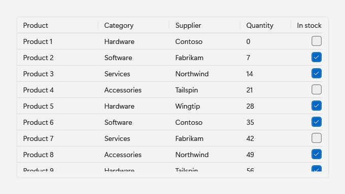
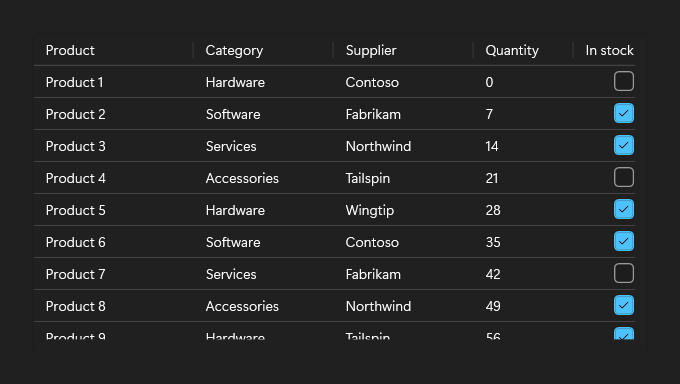

# DataGrid

## Description

DataGrid extends the WPF `DataGrid` to display bound data in rows and columns. It covers the WinUI 3 `TableView` scenarios with WPF names.

Use it for tables that people sort, group, filter, or edit.

| Light | Dark |
| --- | --- |
|  |  |

## Example usage

```xml
<fluence:DataGrid x:Name="ProductsGrid" AutoGenerateColumns="False" FrozenColumnCount="1" IsReadOnly="True">
    <fluence:DataGrid.EmptyContent>
        <TextBlock Text="No products to show." />
    </fluence:DataGrid.EmptyContent>
    <fluence:DataGrid.Columns>
        <DataGridTextColumn Width="160" Binding="{Binding Name}" Header="Product" />
        <DataGridTextColumn Width="140" Binding="{Binding Category}" Header="Category" />
        <DataGridTextColumn Width="100" Binding="{Binding Quantity}" Header="Quantity" />
        <DataGridCheckBoxColumn Width="100" Binding="{Binding InStock}" Header="In stock" />
    </fluence:DataGrid.Columns>
</fluence:DataGrid>
```

```csharp
// Product is an application class with Name, Category, Quantity, and InStock properties.
ProductsGrid.ItemsSource = new ObservableCollection<Product>
{
    new Product { Name = "Laptop", Category = "Hardware", Quantity = 12, InStock = true },
    new Product { Name = "Support plan", Category = "Services", Quantity = 0, InStock = false },
};
```

## Key properties

| Property | Default | Purpose |
| --- | --- | --- |
| `AutoGenerateColumns` | `true` | Creates a column for each property of the row type. |
| `IsReadOnly` | `false` | Prevents cell editing. |
| `FrozenColumnCount` | `0` | Number of leading columns that stay in view during horizontal scrolling. |
| `IsItemSelectable` | `true` | Allows row and cell selection. |
| `EmptyContent` | `null` | Content shown when the grid has no rows. |
| `CornerRadius` | `4` | Rounds the grid border. |

## State and behavior

A header click sorts by that column, and dragging a header edge resizes it. When `IsReadOnly` is `false`, a double-click, F2, or typing begins editing a cell. Enter commits the edit and Esc cancels it. `EmptyContent` appears when the grid has no rows.

## Additional behavior

Group and filter rows through an `ICollectionView`. When `GroupStyle` is empty at load time, the grid supplies collapsible group headers. `ExpandAllGroups` and `CollapseAllGroups` open or close only realized headers of this grid that use the built-in group header.

```csharp
var view = new ListCollectionView(products);
view.GroupDescriptions.Add(new PropertyGroupDescription(nameof(Product.Category)));
view.Filter = item => ((Product)item).InStock;
ProductsGrid.ItemsSource = view;
```

Grouping turns off row virtualization unless `VirtualizingPanel.IsVirtualizingWhenGrouping` is `true`. Set it for a large grouped source.

Row objects that implement `INotifyDataErrorInfo` report validation errors. An invalid cell shows its error message as a tooltip, and a failed commit keeps the editor open.

For cell content other than text or a check box, use a `DataGridTemplateColumn` and set its `SortMemberPath` so its header still sorts. For a drop-down cell, put a Fluence `ComboBox` in a template column. Only leading columns can be frozen.

On an editable source, set `CanUserAddRows` to `false`. Otherwise the new-item row counts as a row and `EmptyContent` stays hidden.

### Selection

Setting `IsItemSelectable` to `false` clears the selection, keeps `SelectedItem`, `SelectedIndex`, and `SelectedValue` empty, and suppresses public and UI Automation selection events for rejected row and cell selections. If you turn the property off while an item is selected, the grid still reports that selection's removal. The grid retains its current-cell APIs, and programmatic editing through `BeginEdit()` remains available. Test input interactions in your application when `IsItemSelectable` is `false`.

Keyboard navigation and F2 editing still work, but a mouse click does not begin editing. WPF can briefly add a rejected entry to its native `SelectedItems` or `SelectedCells` collection before Fluence clears it. The public single-selection properties remain empty, and rejected selection events are suppressed, but the collections are not guaranteed to stay unchanged at every instant. See the [DataGrid selection limitation](https://github.com/sintaxasn/Fluence.Wpf/blob/main/KNOWN_ISSUES.md#datagrid-can-briefly-report-a-rejected-selection-in-native-collections).

### Grid lines across theme changes

A frozen `SolidColorBrush` assigned to `HorizontalGridLinesBrush` or `VerticalGridLinesBrush` reads back as a grid-owned copy with the same color. This keeps an open cell edit when the theme or accent changes.

## Events

The inherited `SelectionChanged` and `SelectedCellsChanged` events report a changed selection. `Sorting` reports a header sort, and `CellEditEnding` and `RowEditEnding` report the end of an edit.

## Related

- [C# how-to guide](../how-to/inputs-and-data.md)
- [PowerShell how-to guide](../powershell/how-to/windows-from-xaml.md#bind-powershell-objects-to-a-datagrid)
- [WinUI parity and differences](../winui-parity.md#differences-to-account-for)

## Reference

- [C# API reference](../api/Fluence.Wpf.Controls/DataGrid.md)
- [Gallery XAML source](../../Fluence.Wpf.Demo/Pages/GalleryDataGridPage.xaml)
- [Gallery C# source](../../Fluence.Wpf.Demo/Pages/GalleryDataGridPage.xaml.cs)
- [Control source](../../Fluence.Wpf/Controls/DataGrid.cs)
- [Control catalog](../controls.md)
