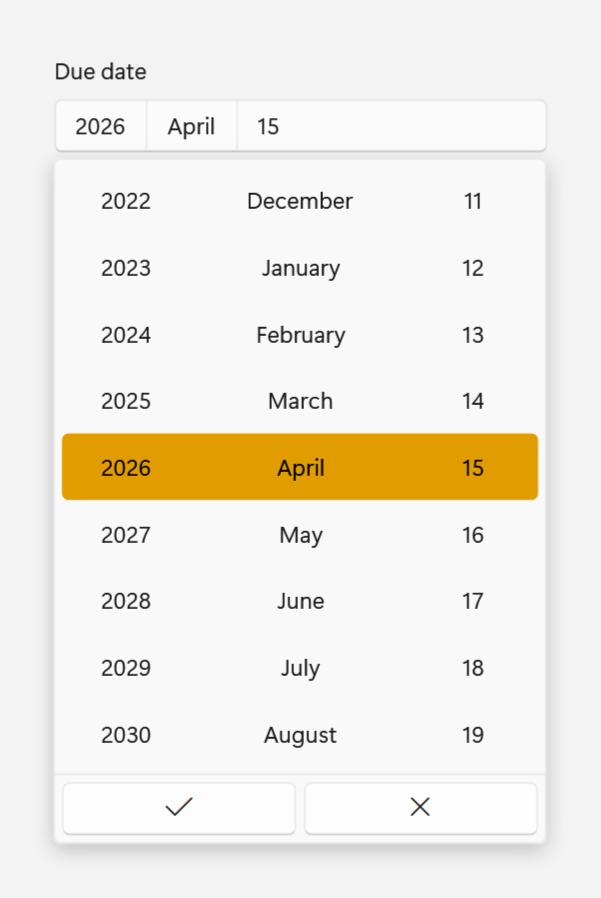
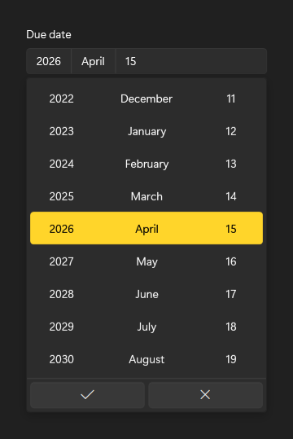

# DatePicker

## Description

Use DatePicker for choosing a date from day, month, and year columns in a flyout.

| Light | Dark |
| --- | --- |
|  |  |

### Open picker





## Example usage

```xml
<fluence:DatePicker Header="Due date" PlaceholderText="Pick a date" />
```

```csharp
var date = new Fluence.Wpf.Controls.DatePicker { Header = "Due date" };
```

## Key properties

| Property | Default | Purpose |
| --- | --- | --- |
| `SelectedDate` | `null` | Selected date as a nullable value. |
| `MinYear` | `1900` | First selectable year. |
| `MaxYear` | `2100` | Last selectable year. |
| `DayVisible`, `MonthVisible`, `YearVisible` | `true` | Show or hide each date column. |
| `Header` | `null` | Optional label above the field. |

## State and behavior

Opening the picker exposes day, month, and year columns; selection updates SelectedDate.

## Additional behavior

The Fluence [DatePicker](date-picker.md) is a `Control` with a three-column picker, not a subclass of the native WPF calendar picker. Use its own `SelectedDate` API. See [inputs and data](../how-to/inputs-and-data.md) and the gallery's Inputs and Forms pages.

## Events

`SelectedDateChanged` reports a changed selected date.

## Related

- [C# how-to guide](../how-to/inputs-and-data.md)

## Reference

- [C# API reference](../api/Fluence.Wpf.Controls/DatePicker.md)
- [Gallery XAML source](../../Fluence.Wpf.Demo/Pages/GalleryFormsPage.xaml)
- [Gallery C# source](../../Fluence.Wpf.Demo/Pages/GalleryFormsPage.xaml.cs)
- [Control source](../../Fluence.Wpf/Controls/DatePicker.cs)
- [Control catalog](../controls.md)
