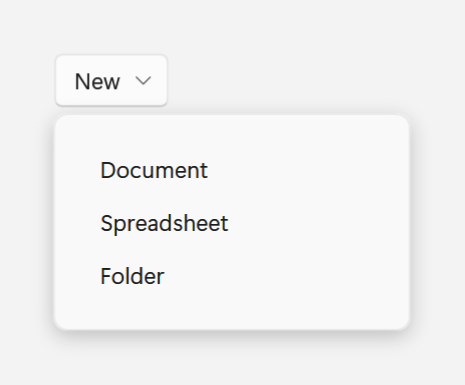
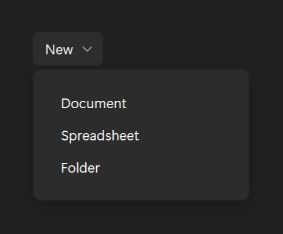

# DropDownButton

## Description

Use DropDownButton when all available actions live in the flyout.

| Light | Dark |
| --- | --- |
|  |  |

### Open flyout





## Example usage

```xml
<fluence:DropDownButton Content="New">
    <fluence:DropDownButton.Flyout>
        <StackPanel>
            <fluence:Button Content="Document" Command="{Binding NewDocumentCommand}" />
            <fluence:Button Content="Folder" Command="{Binding NewFolderCommand}" />
        </StackPanel>
    </fluence:DropDownButton.Flyout>
</fluence:DropDownButton>
```

```csharp
var button = new Fluence.Wpf.Controls.DropDownButton { Content = "New" };
```

Bind the two commands on the page's data context to make the flyout choices act on your content.

## Key properties

| Property | Default | Purpose |
| --- | --- | --- |
| `Flyout` | `null` | Flyout shown by the button. |
| `FlyoutTemplate` | `null` | Template used to create flyout content. |
| `DropdownCornerRadius` | `8` | Rounds the drop-down surface. |

## State and behavior

Opening the flyout changes the button state; light dismissal closes it.

## Related

- [C# how-to guide](../how-to/dialogs-and-feedback.md)

## Reference

- [C# API reference](../api/Fluence.Wpf.Controls/DropDownButton.md)
- [Gallery XAML source](../../Fluence.Wpf.Demo/Pages/GalleryButtonsPage.xaml)
- [Gallery C# source](../../Fluence.Wpf.Demo/Pages/GalleryButtonsPage.xaml.cs)
- [Control source](../../Fluence.Wpf/Controls/DropDownButton.cs)
- [Control catalog](../controls.md)
