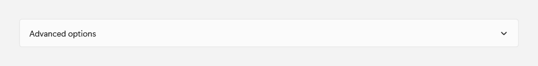
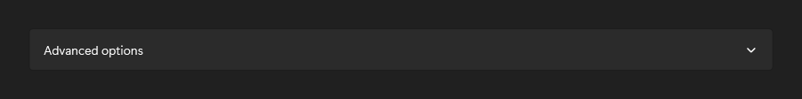
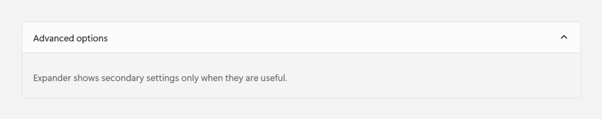
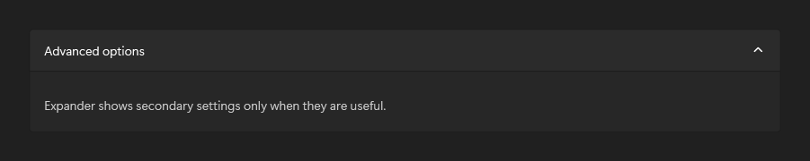

# Expander

## Description

Use Expander for secondary settings that should start collapsed until needed.

| Light | Dark |
| --- | --- |
|  |  |

### Expanded state {#captured-state-changes}




## Example usage

```xml
<fluence:Expander Header="Advanced options" IsExpanded="False">
    <fluence:ToggleSwitch HeaderContent="Send notifications" />
</fluence:Expander>
```

```csharp
var section = new Fluence.Wpf.Controls.Expander { Header = "Advanced options" };
```

## Key properties

| Property | Default | Purpose |
| --- | --- | --- |
| `IsExpanded` | `false` (WPF default) | Controls whether the content is expanded. |
| `Header` | `null` (WPF default) | Content displayed in the header. |
| `CornerRadius` | `4` | Rounds the expander. |
| `HeaderBackground` | `null` | Optional header background. |

## State and behavior

IsExpanded reveals or hides secondary content; the header remains visible.

## Events

The inherited `Expanded` and `Collapsed` events report changes in expansion.

## Related

- [C# how-to guide](../how-to/inputs-and-data.md)

## Reference

- [C# API reference](../api/Fluence.Wpf.Controls/Expander.md)
- [Gallery XAML source](../../Fluence.Wpf.Demo/Pages/GalleryLayoutPage.xaml)
- [Gallery C# source](../../Fluence.Wpf.Demo/Pages/GalleryLayoutPage.xaml.cs)
- [Control source](../../Fluence.Wpf/Controls/Expander.cs)
- [Control catalog](../controls.md)
