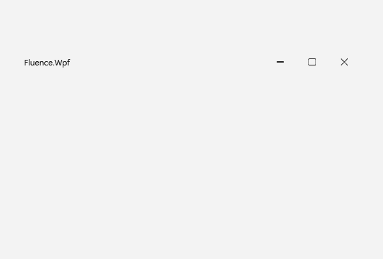
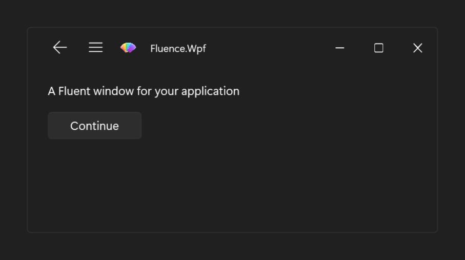

# FluenceWindow

## Description

`FluenceWindow` derives from WPF `Window`. It provides custom DWM window chrome, optional content in the title bar, caption button controls, and Fluence theme integration. Its properties below extend the normal WPF window API. For a complete window example, see [Basic walkthrough](../csharp/usage.md).

Use it as the main window when an app needs Fluence chrome, a custom title bar, or a system backdrop.

| Light | Dark |
| --- | --- |
|  |  |

## Example usage

Initialize the theme before creating or showing a window. Remove `StartupUri` from `App.xaml` when creating the window in `OnStartup`, as described in [Basic walkthrough](../csharp/usage.md#initialize-the-application). `SystemBackdropType` is a per-window request. The default is `Auto`; the operating system and current theme determine the available effect.

```xml
<fluence:FluenceWindow x:Class="MyApp.MainWindow"
    xmlns="http://schemas.microsoft.com/winfx/2006/xaml/presentation"
    xmlns:x="http://schemas.microsoft.com/winfx/2006/xaml"
    xmlns:fluence="http://schemas.fluencewpf.com"
    Title="My app"
    Width="900"
    Height="640"
    SystemBackdropType="Auto"
    CornerStyle="Round">
    <Grid />
</fluence:FluenceWindow>
```
```csharp
using System.Windows;
using Fluence.Wpf;
using Fluence.Wpf.Controls;

namespace MyApp
{
    public partial class MainWindow : FluenceWindow
    {
        public MainWindow()
        {
            InitializeComponent();
        }
    }

    public partial class App : Application
    {
        protected override void OnStartup(StartupEventArgs e)
        {
            ApplicationThemeManager.Apply(ApplicationTheme.Light);
            base.OnStartup(e);

            MainWindow mainWindow = new MainWindow();
            mainWindow.Show();
        }
    }
}
```

The `FluenceWindow` dependency properties add to, rather than replace, inherited `Window` properties such as `Title`, `Width`, `Height`, `ResizeMode`, `WindowStartupLocation`, `Owner`, and `Content`.

## State and behavior

### FluenceWindow properties
| Property | Default | Purpose |
| --- | --- | --- |
| `SystemBackdropType` | `WindowBackdropType.Auto` | Requests `Auto`, `Mica`, `Acrylic`, `Tabbed`, or `None` for this window. |
| `CornerStyle` | `WindowCornerPreference.Round` | Requests `Default`, `DoNotRound`, `Round`, or `RoundSmall` corners. Windows may ignore unsupported requests. |
| `ExtendsContentIntoTitleBar` | `false` | Extends the client area into the title bar region. Set true when supplying a custom title bar. |
| `TitleBar` | `null` | Optional `UIElement` used as custom title-bar content. `SetTitleBar(UIElement?)` is also available. |
| `TitleBarHeight` | `48` device-independent units | Height of the title-bar hit-test region. |
| `ShowIcon`, `ShowTitle` | `true` | Controls the standard icon and title display. |
| `IsMinimizeButtonVisible`, `IsMaximizeButtonVisible`, `IsCloseButtonVisible` | `Visibility.Visible` | Overrides visibility for the corresponding caption control. |
| `IsMinimizable`, `IsMaximizable`, `IsClosable` | `true` | Enables or disables the corresponding caption action. |
| `IsMoveable` | `true` | Allows dragging the window from noninteractive title-bar space. |
| `HasShadow` | `true` | Requests the window shadow. |
| `MarginMaximized` | `Thickness(0)` | Maximized frame margin used by the custom chrome implementation. Normally leave the system-calculated value alone. |

The visibility and capability properties serve different purposes: visibility controls whether a caption button is shown, while the `Is*able` properties control whether the action is permitted. `ResizeMode` remains a WPF constraint and can also limit minimize/maximize behavior.

### Backdrops and platform behavior

`FluenceWindow` uses the theme's `NavigationViewContentBackgroundBrush` for the NavigationView content layer over Mica. Dark Mica uses its canonical translucent `#4C3A3A3A` layer on 10-bit displays with advanced color off. The window's backdrop compensation preserves the source header tint. Applications can provide a window-scoped `NavigationViewContentBackgroundBrush` resource to own that surface.


`ApplicationThemeManager.Apply(theme, backdrop)` records an application-level backdrop request and raises the manager change event when appropriate. `FluenceWindow` does not read `CurrentBackdrop` as a global default: choose the requested effect on each window with `SystemBackdropType`.

Mica, Acrylic, Tabbed, and rounded-corner requests depend on Windows capabilities. Windows 11 uses DWM system backdrop support where available. On Windows 10, the library uses its documented fallback; high contrast uses an opaque surface. The OS can ignore unsupported corner requests. See [Windows and backdrop support](../csharp/requirements.md#windows-and-backdrop-support).

`FluenceWindow` begins watching relevant system theme changes when its native window is initialized and updates its chrome accordingly. Call `ApplicationThemeManager.Apply` before showing windows so Fluence resources are ready.

## Additional behavior

[FluenceWindow](fluence-window.md) extends `Window`. `SystemBackdropType` requests Mica, Acrylic, Tabbed, Auto, or None. `Window.Icon` is unset by default so WPF can use the consumer application's icon or the Windows default; set it to `FluenceWindow.DefaultIcon` to opt into Fluence branding. Its [TitleBar](#title-bar) property accepts a UI element; the [TitleBar](#title-bar) control raises `BackRequested` and `PaneToggleRequested`.

On Windows 11 with Snap layouts enabled, the Maximize and Restore caption glyphs expose Snap hover and perform their window action when clicked. The window handles the caption action on mouse release.

## TitleBar {#title-bar}

### Description {#title-bar-description}

`TitleBar` is a Fluence `ContentControl` designed for use in a `FluenceWindow` title-bar region. It renders title metadata, optional back and pane-toggle buttons, header slots, and centered custom content. It does not perform navigation or toggle a navigation pane by itself; connect its command properties or request events to your application behavior.

Use it in a FluenceWindow when the window needs title metadata or application navigation controls.

The window example above shows the title bar within its surrounding window.

### Example usage {#title-bar-example-usage}

Initialize theme resources before creating the window. If startup code creates the window in `OnStartup`, remove `StartupUri` from `App.xaml`; see [Basic walkthrough](../csharp/usage.md#initialize-the-application).

Set `ExtendsContentIntoTitleBar` on the containing window and assign a `TitleBar` to its `TitleBar` content property. The window's default title-bar height is 48 device-independent units. `TitleBar.IsCompact` selects the 32-unit compact layout.

```xml
<fluence:FluenceWindow x:Class="MyApp.MainWindow"
    xmlns="http://schemas.microsoft.com/winfx/2006/xaml/presentation"
    xmlns:x="http://schemas.microsoft.com/winfx/2006/xaml"
    xmlns:fluence="http://schemas.fluencewpf.com"
    Title="My app"
    ExtendsContentIntoTitleBar="True">
    <fluence:FluenceWindow.TitleBar>
        <fluence:TitleBar Title="My app"
            Subtitle="Workspace"
            IsBackButtonVisible="True"
            IsPaneToggleButtonVisible="True"
            BackRequested="TitleBar_BackRequested"
            PaneToggleRequested="TitleBar_PaneToggleRequested" />
    </fluence:FluenceWindow.TitleBar>
    <fluence:NavigationView x:Name="AppNavigation">
        <fluence:NavigationView.Content>
            <Frame x:Name="MainFrame" />
        </fluence:NavigationView.Content>
    </fluence:NavigationView>
</fluence:FluenceWindow>
```
```csharp
using System;
using System.Windows;
using Fluence.Wpf.Controls;

namespace MyApp
{
    public partial class MainWindow : FluenceWindow
    {
        public MainWindow()
        {
            InitializeComponent();
        }

        private void TitleBar_BackRequested(object sender, EventArgs e)
        {
            if (MainFrame.CanGoBack)
            {
                MainFrame.GoBack();
            }
        }

        private void TitleBar_PaneToggleRequested(object sender, EventArgs e)
        {
            AppNavigation.IsPaneOpen = !AppNavigation.IsPaneOpen;
        }
    }
}
```

The XAML declares `MainFrame` inside `AppNavigation`, so the handlers can use the named controls directly. If a request event is used, implement the corresponding application action there. Alternatively, assign `BackCommand` or `PaneToggleCommand` and optional command parameters. A command that cannot execute disables its button; the request event is raised after a command executes successfully, or after a click when no command is assigned.

### State and behavior {#title-bar-state-and-behavior}

| Property or event | Default | Purpose |
| --- | --- | --- |
| `Title`, `Subtitle` | Empty string | Text displayed in the title bar. |
| `Icon` | `null` | Object displayed as the title icon. |
| `IsBackButtonVisible` | `false` | Shows the back button when true. |
| `IsPaneToggleButtonVisible` | `false` | Shows the pane-toggle button when true. |
| `IsCompact` | `false` | Uses a 32-unit title bar instead of the standard 48-unit layout. |
| `LeftHeader`, `RightHeader` | `null` | Content slots to the left and right of the central title-bar area. |
| `CustomContent` | `null` | Content displayed in the centered slot. |
| `BackCommand`, `PaneToggleCommand` | `null` | Commands invoked by their respective buttons. |
| `BackCommandParameter`, `PaneToggleCommandParameter` | `null` | Parameters passed to those commands. |
| `BackRequested`, `PaneToggleRequested` | Not applicable | Events for handling button requests in code. |

Interactive custom content placed in the extended chrome must set `WindowChrome.IsHitTestVisibleInChrome="True"` so WPF can route pointer input to it. The [gallery title bar](../../Fluence.Wpf.Demo/MainWindow.xaml) demonstrates this on its search control. Keep the title bar's content within the available space beside the caption controls.

### Additional behavior {#title-bar-additional-behavior}

The `TitleBar` provides `LeftHeader` and `RightHeader` slots for custom content. When hosted by `FluenceWindow`, the right header sits before the actual caption-button area; a standalone `TitleBar` reserves no caption-button space. `TitleBarGlyphButtonStyle` is a keyed public resource for buttons in either header whose `Content` is a Segoe Fluent Icons glyph string.

### Reference {#title-bar-reference}

- [C# API reference](../api/Fluence.Wpf.Controls/TitleBar.md)
- [Gallery XAML source](../../Fluence.Wpf.Demo/MainWindow.xaml)
- [Gallery C# source](../../Fluence.Wpf.Demo/MainWindow.xaml.cs)
- [Control source](../../Fluence.Wpf/Controls/TitleBar.cs)
- [Control catalog](../controls.md)

<span id="title-bar-related"></span>

## Related

- [Window and title bar guide](../how-to/window-and-title-bar.md)
- [Navigation and tabs guide](../how-to/navigation-and-tabs.md)

## Reference

- [C# API reference](../api/Fluence.Wpf.Controls/FluenceWindow.md)
- [Gallery XAML source](../../Fluence.Wpf.Demo/MainWindow.xaml)
- [Gallery C# source](../../Fluence.Wpf.Demo/MainWindow.xaml.cs)
- [Control source](../../Fluence.Wpf/Controls/FluenceWindow.cs)
- [Control catalog](../controls.md)
