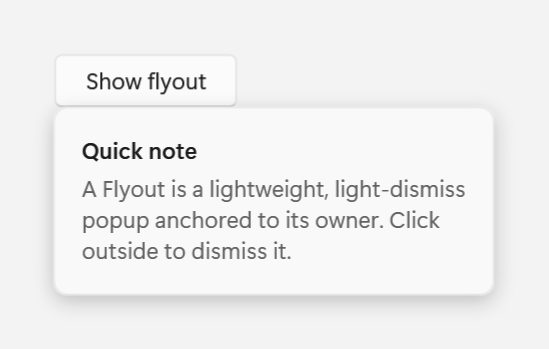
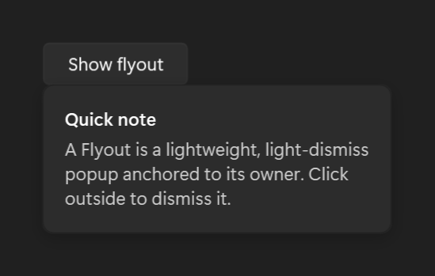

# Flyout

## Description

Use Flyout for lightweight, light-dismiss popups (details, quick forms, confirmations) anchored to a control.

The images show the open popup. A closed flyout has no visible surface.

| Light | Dark |
| --- | --- |
|  |  |

## Example usage

```xml
<fluence:Button Content="More" Click="ShowFlyoutButton_Click">
    <fluence:FlyoutBase.AttachedFlyout>
        <fluence:Flyout Content="Details" />
    </fluence:FlyoutBase.AttachedFlyout>
</fluence:Button>
```

In the window or page code-behind:

```csharp
private void ShowFlyoutButton_Click(object sender, System.Windows.RoutedEventArgs e)
{
    if (sender is System.Windows.FrameworkElement target)
    {
        Fluence.Wpf.Controls.FlyoutBase.ShowAttachedFlyout(target);
    }
}
```

## Key properties

| Property | Default | Purpose |
| --- | --- | --- |
| `Content` | `null` | Content shown in the flyout. |
| `FlyoutPresenterStyle` | `null` | Optional presenter style. |
| `Placement` | `Top` | Positions the flyout relative to its target. |
| `ShouldConstrainToRootBounds` | `true` | Accepted for WinUI API compatibility; WPF popup placement does not enforce this value. |

## State and behavior

The anchored popup opens on request and closes on light dismissal or Hide.

## Parts

### FlyoutBase {#flyout-base}

#### Description {#flyout-base-description}

FlyoutBase defines the attached and programmatic flyout APIs used by concrete flyouts. The screenshots show `FlyoutBase` inside `Flyout`.

Use its attached flyout API when a control needs a concrete Flyout or CommandBarFlyout.

The images show an open Flyout, a concrete implementation of FlyoutBase.

The parent control capture above shows this part in context.

#### Example usage {#flyout-base-example-usage}

```xml
<fluence:Button Content="More" Click="ShowFlyoutButton_Click">
    <fluence:FlyoutBase.AttachedFlyout>
        <fluence:Flyout Content="Details" />
    </fluence:FlyoutBase.AttachedFlyout>
</fluence:Button>
```

In the window or page code-behind:

```csharp
private void ShowFlyoutButton_Click(object sender, System.Windows.RoutedEventArgs e)
{
    if (sender is System.Windows.FrameworkElement target)
    {
        Fluence.Wpf.Controls.FlyoutBase.ShowAttachedFlyout(target);
    }
}
```

#### State and behavior {#flyout-base-state-and-behavior}

FlyoutBase is abstract; attach a concrete Flyout or CommandBarFlyout and use ShowAt or Hide.

#### Reference {#flyout-base-reference}

- [C# API reference](../api/Fluence.Wpf.Controls/FlyoutBase.md)
- [Gallery XAML source](../../Fluence.Wpf.Demo/Pages/GalleryMenusPage.xaml)
- [Gallery C# source](../../Fluence.Wpf.Demo/Pages/GalleryMenusPage.xaml.cs)
- [Control source](../../Fluence.Wpf/Controls/FlyoutBase.cs)
- [Control catalog](../controls.md)

### FlyoutPresenter {#flyout-presenter}

#### Description {#flyout-presenter-description}

FlyoutPresenter draws the popup surface for Flyout content. The screenshots show `FlyoutPresenter` inside `Flyout`.

Use it through Flyout when popup content needs the standard presentation surface.

The images show the presenter while its flyout is open.

The parent control capture above shows this part in context.

#### Example usage {#flyout-presenter-example-usage}

```xml
<fluence:Button Content="More" Click="ShowFlyoutButton_Click">
    <fluence:FlyoutBase.AttachedFlyout>
        <fluence:Flyout Content="Details" />
    </fluence:FlyoutBase.AttachedFlyout>
</fluence:Button>
```

In the window or page code-behind:

```csharp
private void ShowFlyoutButton_Click(object sender, System.Windows.RoutedEventArgs e)
{
    if (sender is System.Windows.FrameworkElement target)
    {
        Fluence.Wpf.Controls.FlyoutBase.ShowAttachedFlyout(target);
    }
}
```

#### State and behavior {#flyout-presenter-state-and-behavior}

The presenter is the visual surface created for Flyout content; its appearance follows the theme.

#### Reference {#flyout-presenter-reference}

- [C# API reference](../api/Fluence.Wpf.Controls/FlyoutPresenter.md)
- [Gallery XAML source](../../Fluence.Wpf.Demo/Pages/GalleryMenusPage.xaml)
- [Gallery C# source](../../Fluence.Wpf.Demo/Pages/GalleryMenusPage.xaml.cs)
- [Control source](../../Fluence.Wpf/Controls/FlyoutPresenter.cs)
- [Control catalog](../controls.md)

## Additional behavior

[FlyoutBase](flyout-base.md) is an abstract support type. `ContentDialog.ShowAsync` needs an active owner and must run on the UI dispatcher. See [dialogs and feedback](../how-to/dialogs-and-feedback.md).

## Events

`Opening` and `Opened` report opening. `Hide()` raises `Closing`, which can be canceled, followed by `Closed` when the popup closes. The light-dismiss handlers call `Hide()`.

## Related

- [C# how-to guide](../how-to/dialogs-and-feedback.md)

## Reference

- [C# API reference](../api/Fluence.Wpf.Controls/Flyout.md)
- [Gallery XAML source](../../Fluence.Wpf.Demo/Pages/GalleryMenusPage.xaml)
- [Gallery C# source](../../Fluence.Wpf.Demo/Pages/GalleryMenusPage.xaml.cs)
- [Control source](../../Fluence.Wpf/Controls/Flyout.cs)
- [Control catalog](../controls.md)
