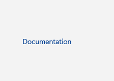
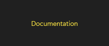

# HyperlinkButton

## Description

HyperlinkButton extends the WPF `Button` for link-style navigation or actions.

| Light | Dark |
| --- | --- |
|  |  |

## Example usage

```xml
<fluence:HyperlinkButton
    Content="Documentation"
    NavigateUri="https://github.com/sintaxasn/Fluence.Wpf" />
```

```csharp
var link = new Fluence.Wpf.Controls.HyperlinkButton
{
    Content = "Documentation",
    NavigateUri = new System.Uri("https://github.com/sintaxasn/Fluence.Wpf"),
};
```

## Key properties

| Property | Default | Purpose |
| --- | --- | --- |
| `NavigateUri` | `null` | Absolute URI opened via the shell on click. |
| `Icon` | `null` | Optional icon content. |
| `IconPlacement` | `Left` | Places the icon relative to the label. |
| `CornerRadius` | `4` | Sets the corner radius. |

## State and behavior

The link responds to pointer and keyboard input; disabled links do not activate.

The control uses shell execution for `NavigateUri` after raising the normal button click. Supply an absolute URI.

## Events

The inherited `Click` event is raised on activation.

## Related

- [C# how-to guide](../how-to/navigation-and-tabs.md)

## Reference

- [C# API reference](../api/Fluence.Wpf.Controls/HyperlinkButton.md)
- [Gallery XAML source](../../Fluence.Wpf.Demo/Pages/GalleryButtonsPage.xaml)
- [Gallery C# source](../../Fluence.Wpf.Demo/Pages/GalleryButtonsPage.xaml.cs)
- [Control source](../../Fluence.Wpf/Controls/HyperlinkButton.cs)
- [Control catalog](../controls.md)
