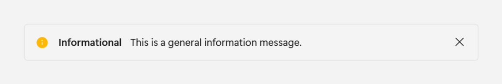

# InfoBar

## Description

Use InfoBar for inline messages that explain status, validation, or recoverable outcomes.

| Light | Dark |
| --- | --- |
|  |  |

### Captured state changes

**Dismissed**


## Example usage

```xml
<fluence:InfoBar
    Title="Saved"
    Content="Your changes are ready."
    Severity="Success"
    IsOpen="True" />
```

```csharp
var info = new Fluence.Wpf.Controls.InfoBar { Title = "Saved", IsOpen = true };
```

## Key properties

| Property | Default | Purpose |
| --- | --- | --- |
| `Title` | `null` | Title shown with the message. |
| `Message` | `null` | Message text. |
| `Severity` | `Informational` | Visual severity. |
| `IsOpen` | `false` | Shows the bar. |
| `IsClosable` | `true` | Shows the close affordance. |
| `IsIconVisible` | `true` | Shows the severity icon. |

## State and behavior

IsOpen shows or dismisses the message; Severity changes the visual treatment.

## Events

`CloseButtonClick`, `Opened`, `Closing`, and `Closed` report interactions and lifecycle changes.

## Related

- [C# how-to guide](../how-to/dialogs-and-feedback.md)

## Reference

- [C# API reference](../api/Fluence.Wpf.Controls/InfoBar.md)
- [Gallery XAML source](../../Fluence.Wpf.Demo/Pages/GalleryStatusPage.xaml)
- [Gallery C# source](../../Fluence.Wpf.Demo/Pages/GalleryStatusPage.xaml.cs)
- [Control source](../../Fluence.Wpf/Controls/InfoBar.cs)
- [Control catalog](../controls.md)
