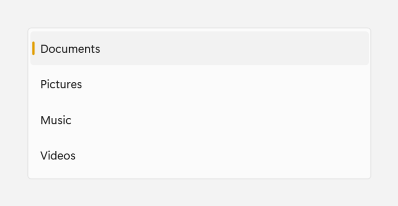
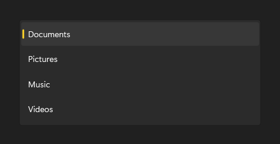

# ListBox

## Description

Use ListBox for compact selection lists; set SelectionMode to Extended to allow selecting multiple items.

| Light | Dark |
| --- | --- |
|  |  |

## Example usage

```xml
<fluence:ListBox SelectionMode="Extended">
    <fluence:ListBoxItem Content="Documents" />
    <fluence:ListBoxItem Content="Pictures" />
</fluence:ListBox>
```

```csharp
var list = new Fluence.Wpf.Controls.ListBox();
list.Items.Add("First");
```

## Key properties

| Property | Default | Purpose |
| --- | --- | --- |
| `ItemsSource` | `null` (WPF default) | Collection shown in the list. |
| `SelectionMode` | `Single` (WPF default) | Controls single or multiple selection. |
| `CornerRadius` | `4` | Rounds the list surface. |

## State and behavior

SelectionMode controls single or extended selection; selected items receive a distinct state.

## Parts

### ListBoxItem {#list-box-item}

#### Description {#list-box-item-description}

ListBoxItem is the visible selectable container inside ListBox. The screenshots show `ListBoxItem` inside `ListBox`.

Use it as an item container within a ListBox.

The parent control capture above shows this part in context.

#### Example usage {#list-box-item-example-usage}

```xml
<fluence:ListBox>
    <fluence:ListBoxItem Content="Documents" IsSelected="True" />
    <fluence:ListBoxItem Content="Pictures" />
</fluence:ListBox>
```

#### State and behavior {#list-box-item-state-and-behavior}

The item container shows selection, pointer, focus, and disabled states within ListBox.

#### Reference {#list-box-item-reference}

- [C# API reference](../api/Fluence.Wpf.Controls/ListBoxItem.md)
- [Gallery XAML source](../../Fluence.Wpf.Demo/Pages/GalleryDataPage.xaml)
- [Gallery C# source](../../Fluence.Wpf.Demo/Pages/GalleryDataPage.xaml.cs)
- [Control source](../../Fluence.Wpf/Controls/ListBoxItem.cs)
- [Control catalog](../controls.md)

## Events

The inherited `SelectionChanged` event reports a changed selection.

## Related

- [C# how-to guide](../how-to/inputs-and-data.md)

## Reference

- [C# API reference](../api/Fluence.Wpf.Controls/ListBox.md)
- [Gallery XAML source](../../Fluence.Wpf.Demo/Pages/GalleryDataPage.xaml)
- [Gallery C# source](../../Fluence.Wpf.Demo/Pages/GalleryDataPage.xaml.cs)
- [Control source](../../Fluence.Wpf/Controls/ListBox.cs)
- [Control catalog](../controls.md)
