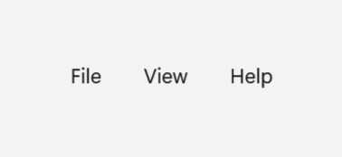
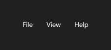
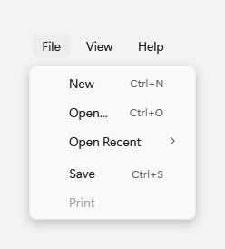
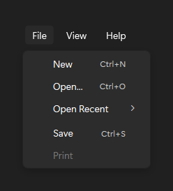

# Menu

## Description

Use Menu for persistent command groups with submenus, keyboard cues, separators, and checked states.

| Light | Dark |
| --- | --- |
|  |  |

### Open submenu





## Example usage

```xml
<fluence:Menu>
    <fluence:MenuItem Header="_File">
        <fluence:MenuItem Header="_Open" />
    </fluence:MenuItem>
</fluence:Menu>
```

```csharp
var menu = new Fluence.Wpf.Controls.Menu();
menu.Items.Add(new Fluence.Wpf.Controls.MenuItem { Header = "File" });
```

## Key properties

| Property | Default | Purpose |
| --- | --- | --- |
| `Items` | Empty collection (WPF default) | Menu items to display. |
| `IsEnabled` | `true` (WPF default) | Enables menu interaction. |

## State and behavior

Opening a menu reveals commands; checked, keyboard focus, and disabled menu items have distinct states.

## Parts

### MenuItem {#menu-item}

#### Description {#menu-item-description}

MenuItem is a command or submenu entry inside Menu or ContextMenu. The screenshots show `MenuItem` inside `Menu`.

Use it for commands or nested choices inside Menu or ContextMenu.

The parent control capture above shows this part in context.

#### Example usage {#menu-item-example-usage}

```xml
<fluence:Menu>
    <fluence:MenuItem Header="_File">
        <fluence:MenuItem Header="_Open" Command="{Binding OpenCommand}" />
        <fluence:MenuItem Header="Status bar" IsCheckable="True" IsChecked="True" />
    </fluence:MenuItem>
</fluence:Menu>
```

#### State and behavior {#menu-item-state-and-behavior}

MenuItem can open a submenu, toggle a checked state, or invoke a command.

#### Reference {#menu-item-reference}

- [C# API reference](../api/Fluence.Wpf.Controls/MenuItem.md)
- [Gallery XAML source](../../Fluence.Wpf.Demo/Pages/GalleryMenusPage.xaml)
- [Gallery C# source](../../Fluence.Wpf.Demo/Pages/GalleryMenusPage.xaml.cs)
- [Control source](../../Fluence.Wpf/Controls/MenuItem.cs)
- [Control catalog](../controls.md)

## Related

- [C# how-to guide](../how-to/dialogs-and-feedback.md)

## Reference

- [C# API reference](../api/Fluence.Wpf.Controls/Menu.md)
- [Gallery XAML source](../../Fluence.Wpf.Demo/Pages/GalleryMenusPage.xaml)
- [Gallery C# source](../../Fluence.Wpf.Demo/Pages/GalleryMenusPage.xaml.cs)
- [Control source](../../Fluence.Wpf/Controls/Menu.cs)
- [Control catalog](../controls.md)
