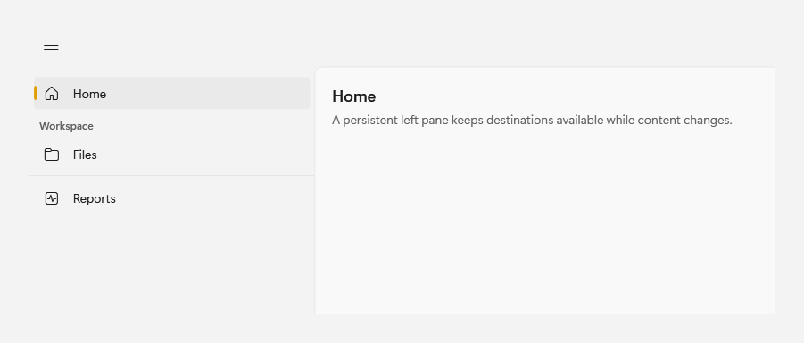
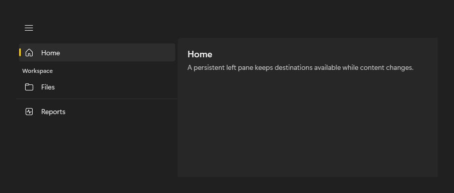

# NavigationView

## Description

NavigationView is a WPF `Selector` that presents application destinations in a left or top pane.

| Light | Dark |
| --- | --- |
|  |  |

## Example usage

```xml
<fluence:NavigationView PaneDisplayMode="Left">
    <fluence:NavigationViewItem Content="Home" IsSelected="True" />
    <fluence:NavigationViewItem Content="Files" />
</fluence:NavigationView>
```

```csharp
var navigation = new Fluence.Wpf.Controls.NavigationView();
navigation.Items.Add(new Fluence.Wpf.Controls.NavigationViewItem { Content = "Home" });
```

## Key properties

| Property | Default | Purpose |
| --- | --- | --- |
| `PaneDisplayMode` | `Left` | Chooses the navigation layout. |
| `IsPaneOpen` | `true` | Controls whether the pane is open. |
| `Content` | `null` | Hosts the current page or view. |
| `FooterMenuItems` | Empty collection | Contains destinations pinned to the pane footer. |
| `IsBackButtonVisible` | `false` | Shows the navigation back button. |

## State and behavior

Selection moves the indicator; pane display mode changes the shell layout and back requests are explicit.

Assign the page host explicitly to `NavigationView.Content`: an unnamed child is added to the item collection instead of becoming the page host. The application controls page history.

## Events

`ItemInvoked` reports a destination invocation. `BackRequested` reports a back-button request; the application owns navigation history.

## Related

- [C# how-to guide](../how-to/navigation-and-tabs.md)

## Parts

### NavigationViewItem {#navigation-view-item}

#### Description {#navigation-view-item-description}

NavigationViewItem is a selectable destination inside NavigationView. The screenshots show `NavigationViewItem` inside `NavigationView`.

Use it for a selectable destination in NavigationView.

| Light | Dark |
| --- | --- |
|  |  |

#### Example usage {#navigation-view-item-example-usage}

```xml
<fluence:NavigationView>
    <fluence:NavigationViewItem Content="Home" IsSelected="True" />
    <fluence:NavigationViewItem Content="Files" />
</fluence:NavigationView>
```

#### State and behavior {#navigation-view-item-state-and-behavior}

Selected and unselected destinations differ visually; InfoBadge can show item status.

#### Reference {#navigation-view-item-reference}

- [C# API reference](../api/Fluence.Wpf.Controls/NavigationViewItem.md)
- [Gallery XAML source](../../Fluence.Wpf.Demo/Pages/GalleryNavigationPage.xaml)
- [Gallery C# source](../../Fluence.Wpf.Demo/Pages/GalleryNavigationPage.xaml.cs)
- [Control source](../../Fluence.Wpf/Controls/NavigationViewItem.cs)
- [Control catalog](../controls.md)

### NavigationViewItemHeader {#navigation-view-item-header}

#### Description {#navigation-view-item-header-description}

Use a header to label a group of destinations in NavigationView. The screenshots show `NavigationViewItemHeader` inside `NavigationView`.

| Light | Dark |
| --- | --- |
|  |  |

#### Example usage {#navigation-view-item-header-example-usage}

```xml
<fluence:NavigationView>
    <fluence:NavigationViewItemHeader Content="Workspace" />
    <fluence:NavigationViewItem Content="Home" />
</fluence:NavigationView>
```

#### State and behavior {#navigation-view-item-header-state-and-behavior}

Headers label groups of NavigationView items; they do not navigate as destinations.

#### Reference {#navigation-view-item-header-reference}

- [C# API reference](../api/Fluence.Wpf.Controls/NavigationViewItemHeader.md)
- [Gallery XAML source](../../Fluence.Wpf.Demo/Pages/GalleryNavigationPage.xaml)
- [Gallery C# source](../../Fluence.Wpf.Demo/Pages/GalleryNavigationPage.xaml.cs)
- [Control source](../../Fluence.Wpf/Controls/NavigationViewItemHeader.cs)
- [Control catalog](../controls.md)

### NavigationViewItemSeparator {#navigation-view-item-separator}

#### Description {#navigation-view-item-separator-description}

Use a separator to divide destination groups in NavigationView. The screenshots show `NavigationViewItemSeparator` inside `NavigationView`.

| Light | Dark |
| --- | --- |
|  |  |

#### Example usage {#navigation-view-item-separator-example-usage}

```xml
<fluence:NavigationView>
    <fluence:NavigationViewItem Content="Home" />
    <fluence:NavigationViewItemSeparator />
    <fluence:NavigationViewItem Content="Settings" />
</fluence:NavigationView>
```

#### State and behavior {#navigation-view-item-separator-state-and-behavior}

Separators divide destination groups and have no selected state.

#### Reference {#navigation-view-item-separator-reference}

- [C# API reference](../api/Fluence.Wpf.Controls/NavigationViewItemSeparator.md)
- [Gallery XAML source](../../Fluence.Wpf.Demo/Pages/GalleryNavigationPage.xaml)
- [Gallery C# source](../../Fluence.Wpf.Demo/Pages/GalleryNavigationPage.xaml.cs)
- [Control source](../../Fluence.Wpf/Controls/NavigationViewItemSeparator.cs)
- [Control catalog](../controls.md)

## Additional behavior

[NavigationView](navigation-view.md) derives from `Selector`. Put its page host in `NavigationView.Content`, because an unnamed child enters the item collection. The application controls its navigation history. [TabView](tab-view.md) extends WPF `TabControl`; a close request does not remove the item for you. See [navigation and tabs](../how-to/navigation-and-tabs.md).

Reordering `NavigationView.FooterMenuItems` preserves a selected item that remains present. Removing or clearing that selected footer item clears its footer selection; it does not select an unrelated main item.

## Reference

- [C# API reference](../api/Fluence.Wpf.Controls/NavigationView.md)
- [Gallery XAML source](../../Fluence.Wpf.Demo/Pages/GalleryNavigationPage.xaml)
- [Gallery C# source](../../Fluence.Wpf.Demo/Pages/GalleryNavigationPage.xaml.cs)
- [Control source](../../Fluence.Wpf/Controls/NavigationView.cs)
- [Control catalog](../controls.md)
