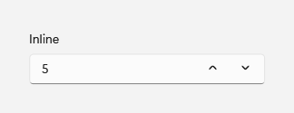
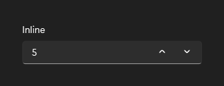

# NumberBox

## Description

NumberBox is a WPF `Control` for numeric entry with optional spin buttons and bounds.

| Light | Dark |
| --- | --- |
|  |  |

## Example usage

```xml
<fluence:NumberBox Header="Inline" Value="5" Minimum="0" />
```

```csharp
var number = new Fluence.Wpf.Controls.NumberBox { Value = 5, Minimum = 0 };
```

## Key properties

| Property | Default | Purpose |
| --- | --- | --- |
| `Value` | `0` | Current numeric value. |
| `Minimum`, `Maximum` | `double.MinValue`, `double.MaxValue` | Bounds for the value. |
| `SmallChange`, `LargeChange` | `1`, `10` | Step sizes for adjustment. |
| `SpinButtonPlacementMode` | `Compact` | Controls where spin buttons appear. |
| `AcceptsExpression` | `false` | Enables arithmetic expression input. |

## State and behavior

Spin buttons and text entry change `Value` within the configured bounds. Text that does not parse leaves `Value` unchanged, and clearing the field sets `Value` to `NaN`.

## Events

`ValueChanged` is raised when the value changes.

## Related

- [C# how-to guide](../how-to/inputs-and-data.md)

See [text input focus and selection](text-box.md#text-input-focus) for the shared WPF editor behavior.

## Reference

- [C# API reference](../api/Fluence.Wpf.Controls/NumberBox.md)
- [Gallery XAML source](../../Fluence.Wpf.Demo/Pages/GalleryInputsPage.xaml)
- [Gallery C# source](../../Fluence.Wpf.Demo/Pages/GalleryInputsPage.xaml.cs)
- [Control source](../../Fluence.Wpf/Controls/NumberBox.cs)
- [Control catalog](../controls.md)
