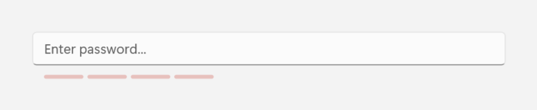
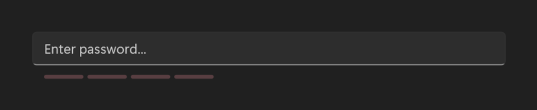

# PasswordBox

<span id="passwordboxextensions"></span>

## Description

PasswordBoxExtensions adds Fluent placeholder, reveal, and feedback properties to native PasswordBox. The screenshots show `PasswordBoxExtensions` inside `PasswordBox`.

The images show the styled PasswordBox with its placeholder.

| Light | Dark |
| --- | --- |
|  |  |

## Example usage

```xml
<PasswordBox fluence:PasswordBoxExtensions.PlaceholderText="Password"
             fluence:PasswordBoxExtensions.RevealButtonEnabled="True" />
```

```csharp
var password = new System.Windows.Controls.PasswordBox();
Fluence.Wpf.Controls.PasswordBoxExtensions.SetPlaceholderText(password, "Password");
```

## Key properties

| Property | Default | Purpose |
| --- | --- | --- |
| `PlaceholderText` | Empty string | Placeholder shown for an empty password. |
| `CornerRadius` | `4` | Rounds the password field. |
| `RevealButtonEnabled` | `true` | Enables the reveal button. |
| `ShowCapsLockIndicator` | `false` | Shows the Caps Lock indicator. |
| `ShowPasswordStrength` | `false` | Shows the strength indicator. |
| `PasswordStrength` | `0` | Value used by the strength indicator. |

## State and behavior

The attached properties add placeholder, reveal, Caps Lock, and strength feedback to native PasswordBox.

## Events

The native `PasswordChanged` event reports changes to the password.

## Related

- [C# how-to guide](../how-to/inputs-and-data.md)

See [text input focus and selection](text-box.md#text-input-focus) for the shared WPF editor behavior.

## Reference

- [C# API reference](../api/Fluence.Wpf.Controls/PasswordBoxExtensions.md)
- [Gallery XAML source](../../Fluence.Wpf.Demo/Pages/GalleryInputsPage.xaml)
- [Gallery C# source](../../Fluence.Wpf.Demo/Pages/GalleryInputsPage.xaml.cs)
- [Control source](../../Fluence.Wpf/Controls/PasswordBoxExtensions.cs)
- [Control catalog](../controls.md)
