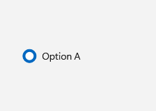
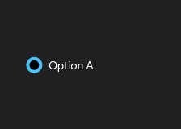

# RadioButton

## Description

Use radio buttons when people must choose exactly one option from a visible group.

| Light | Dark |
| --- | --- |
|  |  |

## Example usage

```xml
<fluence:StackPanel Spacing="8">
    <fluence:RadioButton Content="Option A" GroupName="Choice" IsChecked="True" />
    <fluence:RadioButton Content="Option B" GroupName="Choice" />
</fluence:StackPanel>
```


```csharp
var choice = new Fluence.Wpf.Controls.RadioButton { Content = "Option A", GroupName = "Choice" };
```


## Key properties

| Property | Default | Purpose |
| --- | --- | --- |
| `Description` | `null` | Supporting text for the choice. |
| `CornerRadius` | `10` | Rounds the indicator surface. |
| `GroupName` | Empty string | Groups mutually exclusive choices. |
| `IsChecked` | `false` | Indicates selection. |

## State and behavior

Selecting one choice in a group clears its peer selection.

## Additional behavior

The `RadioButton` keeps native WPF grouping, keyboard navigation, and UI Automation behavior. Its Fluent indicator has a 20-DIP outer ring with a 1-DIP stroke and a 12-DIP checked dot. The dot changes to 14 DIP on hover or when disabled, and to 10 DIP while pressed. The checked dot has no inner stroke in any state. Checking and unchecking change dot opacity immediately. Hover and press size transitions take 250 ms, while disabled sizing takes 167 ms. A separate pressed glyph grows from 4 to 10 DIP in 167 ms. The 32-DIP glyph row uses a 20-DIP icon column, 8-DIP left and 6-DIP top content padding, and a 120-DIP minimum width.

### Theme resource roles

`RadioButtonOuterEllipseCheckedStroke`, `RadioButtonOuterEllipseCheckedStrokePointerOver`, `RadioButtonOuterEllipseCheckedStrokePressed`, and `RadioButtonOuterEllipseCheckedStrokeDisabled` each have a brush twin. In Light and Dark, they follow the checked ring's default, secondary, tertiary, and disabled accent fill roles, respectively. In High Contrast, they map to Highlight, ControlText, Control, and GrayText, respectively, independent of the checked ring fill. Use the state-specific stroke key when customizing the checked outer ring.

## Events

`Checked` and `Unchecked` are raised when selection changes.

## Related

- [C# how-to guide](../how-to/inputs-and-data.md)

## Reference

- [C# API reference](../api/Fluence.Wpf.Controls/RadioButton.md)
- [Gallery XAML source](../../Fluence.Wpf.Demo/Pages/GallerySelectionPage.xaml)
- [Gallery C# source](../../Fluence.Wpf.Demo/Pages/GallerySelectionPage.xaml.cs)
- [Control source](../../Fluence.Wpf/Controls/RadioButton.cs)
- [Control catalog](../controls.md)
