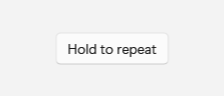
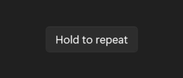

# RepeatButton

## Description

RepeatButton extends the WPF `RepeatButton` and raises repeated clicks while held.

| Light | Dark |
| --- | --- |
|  |  |

## Example usage

```xml
<fluence:RepeatButton Content="Hold to repeat" />
```

```csharp
var repeat = new Fluence.Wpf.Controls.RepeatButton { Content = "Hold to repeat" };
```

## Key properties

| Property | Default | Purpose |
| --- | --- | --- |
| `Appearance` | `Standard` | Selects the button appearance. |
| `CornerRadius` | `4` | Sets the surface corner radius. |
| `Delay`, `Interval` | WPF defaults | Set the delay before repeating and interval between repeats. |

## State and behavior

Holding the pointer raises repeated Click events until release; disabling it stops interaction.

## Events

The inherited `Click` event is raised on each repetition.

## Related

- [C# how-to guide](../how-to/inputs-and-data.md)

## Reference

- [C# API reference](../api/Fluence.Wpf.Controls/RepeatButton.md)
- [Gallery XAML source](../../Fluence.Wpf.Demo/Pages/GalleryButtonsPage.xaml)
- [Gallery C# source](../../Fluence.Wpf.Demo/Pages/GalleryButtonsPage.xaml.cs)
- [Control source](../../Fluence.Wpf/Controls/RepeatButton.cs)
- [Control catalog](../controls.md)
