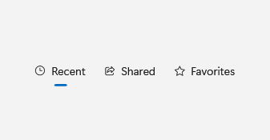
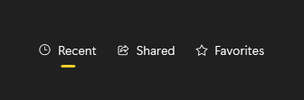
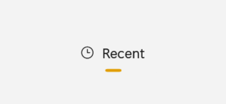

# SelectorBar

## Description

Use SelectorBar to switch between peer views of one page, and SlideNavigationPresenter to slide the view in from the side the selection moved.

| Light | Dark |
| --- | --- |
|  |  |

## Example usage

```xml
<fluence:SelectorBar SelectedIndex="0">
    <fluence:SelectorBarItem Text="Recent" />
    <fluence:SelectorBarItem Text="Shared" />
</fluence:SelectorBar>
```


```csharp
var views = new Fluence.Wpf.Controls.SelectorBar();
views.Items.Add(new Fluence.Wpf.Controls.SelectorBarItem { Text = "Recent" });
```


## Key properties

| Property | Default | Purpose |
| --- | --- | --- |
| `SelectionMode` | `Single` | The control coerces selection to one item. |
| `ItemsSource` | `null` | Supplies view choices from a collection. |
| `DisplayMemberPath` | Empty string | Selects a label member for generated items. |

## State and behavior

Selection changes the active item. Handle `SelectionChanged` or bind `SelectedItem` to update the displayed view; the gallery pairs it with SlideNavigationPresenter.

## Parts

### SelectorBarItem {#selector-bar-item}

#### Description {#selector-bar-item-description}

SelectorBarItem is a selectable view choice inside SelectorBar. The screenshots show `SelectorBarItem` inside `SelectorBar`.

| Light | Dark |
| --- | --- |
|  |  |

#### Example usage {#selector-bar-item-example-usage}

```xml
<fluence:SelectorBar SelectedIndex="0">
    <fluence:SelectorBarItem Text="Recent" />
    <fluence:SelectorBarItem Text="Shared" />
</fluence:SelectorBar>
```

#### State and behavior {#selector-bar-item-state-and-behavior}

The selected item gets the active indicator and its Text and optional Icon remain visible.

#### Reference {#selector-bar-item-reference}

- [C# API reference](../api/Fluence.Wpf.Controls/SelectorBarItem.md)
- [Gallery XAML source](../../Fluence.Wpf.Demo/Pages/GalleryNavigationPage.xaml)
- [Gallery C# source](../../Fluence.Wpf.Demo/Pages/GalleryNavigationPage.xaml.cs)
- [Control source](../../Fluence.Wpf/Controls/SelectorBarItem.cs)
- [Control catalog](../controls.md)

## Events

`SelectionChanged` reports a selection change.

## Related

- [C# how-to guide](../how-to/navigation-and-tabs.md)

## Reference

- [C# API reference](../api/Fluence.Wpf.Controls/SelectorBar.md)
- [Gallery XAML source](../../Fluence.Wpf.Demo/Pages/GalleryNavigationPage.xaml)
- [Gallery C# source](../../Fluence.Wpf.Demo/Pages/GalleryNavigationPage.xaml.cs)
- [Control source](../../Fluence.Wpf/Controls/SelectorBar.cs)
- [Control catalog](../controls.md)
