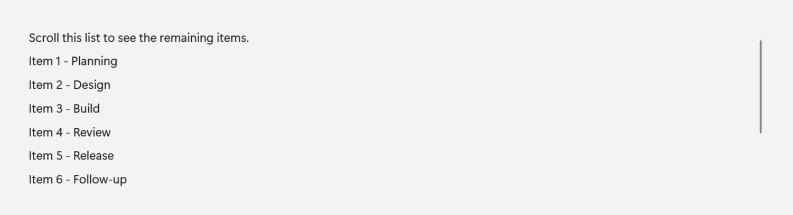
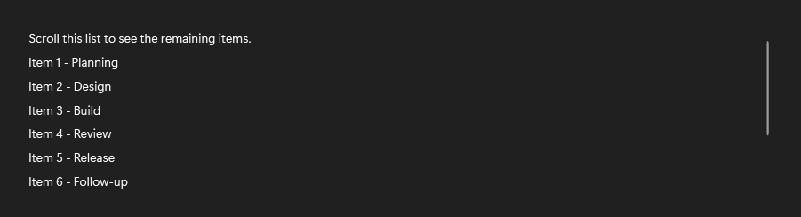
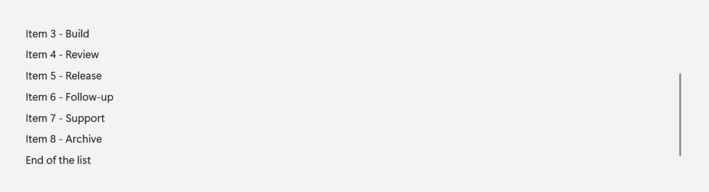
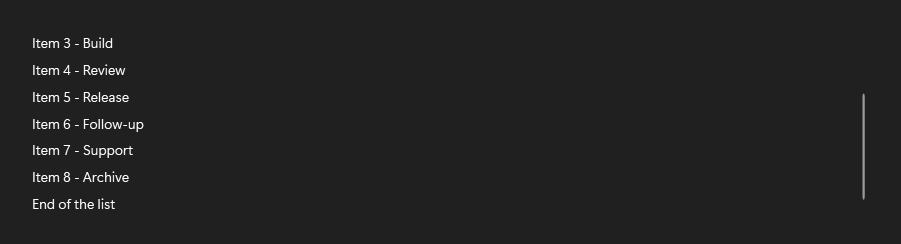

# SmoothScrollViewer

## Description

SmoothScrollViewer hosts content with Fluent scrolling behavior and themed scrollbars.

Use it for scrollable content that should use Fluence scrolling visuals.

| Light | Dark |
| --- | --- |
|  |  |

### After scrolling

The lower items come into view and the scrollbar indicator appears at the right edge.

| Light | Dark |
| --- | --- |
|  |  |

## Example usage

```xml
<fluence:SmoothScrollViewer Height="220">
    <StackPanel Height="500">
        <TextBlock Text="Top of the content" />
        <TextBlock Margin="0,450,0,0" Text="Bottom of the content" />
    </StackPanel>
</fluence:SmoothScrollViewer>
```


```csharp
var viewer = new Fluence.Wpf.Controls.SmoothScrollViewer { ScrollDuration = new System.Windows.Duration(System.TimeSpan.FromMilliseconds(250)) };
```


## Key properties

| Property | Default | Purpose |
| --- | --- | --- |
| `ScrollDuration` | 250 ms | Duration of a smooth scroll animation. |
| `Content` | `null` | Content presented in the scrolling viewport. |

## State and behavior

Scrolling changes the viewport while retaining Fluent scrollbar presentation.

## Parts

### ScrollBarExtensions {#scroll-bar-extensions}

#### Description {#scroll-bar-extensions-description}

ScrollBarExtensions adds indicator behavior to native WPF ScrollBar. The screenshots show `ScrollBarExtensions` inside `SmoothScrollViewer`.

The gallery scroll viewer enables the indicator behavior through its internal scrollbar template. The parent captures above show its vertical scrollbar before and after scrolling, with the indicator visible.

See the parent control captures above for this part in context.

##### After scrolling {#scroll-bar-extensions-after-scrolling}

See the parent control captures above for this part in context.

#### Example usage {#scroll-bar-extensions-example-usage}

```xml
<fluence:SmoothScrollViewer Height="160">
    <StackPanel Height="500">
        <TextBlock Text="Top" />
        <TextBlock Margin="0,450,0,0" Text="Bottom" />
    </StackPanel>
</fluence:SmoothScrollViewer>
```

The Fluence scroll viewer template applies `ScrollBarExtensions.IsIndicatorEnabled` to its internal scroll bars. A custom scrollbar can set that attached property only when its template supports the Fluence indicator states. A standalone bar has no scroll viewer host and stays visible.

#### State and behavior {#scroll-bar-extensions-state-and-behavior}

Attached indicator settings alter the native ScrollBar's indicator presentation during interaction.

#### Reference {#scroll-bar-extensions-reference}

- [C# API reference](../api/Fluence.Wpf.Controls/ScrollBarExtensions.md)
- [Gallery XAML source](../../Fluence.Wpf.Demo/Pages/GalleryLayoutPage.xaml)
- [Gallery C# source](../../Fluence.Wpf.Demo/Pages/GalleryLayoutPage.xaml.cs)
- [Control source](../../Fluence.Wpf/Controls/ScrollBarExtensions.cs)
- [Control catalog](../controls.md)

## Events

`ScrollChanged` reports scrolling and viewport changes.

## Related

- [C# how-to guide](../how-to/window-and-title-bar.md)

## Reference

- [C# API reference](../api/Fluence.Wpf.Controls/SmoothScrollViewer.md)
- [Gallery XAML source](../../Fluence.Wpf.Demo/Pages/GalleryLayoutPage.xaml)
- [Gallery C# source](../../Fluence.Wpf.Demo/Pages/GalleryLayoutPage.xaml.cs)
- [Control source](../../Fluence.Wpf/Controls/SmoothScrollViewer.cs)
- [Control catalog](../controls.md)
