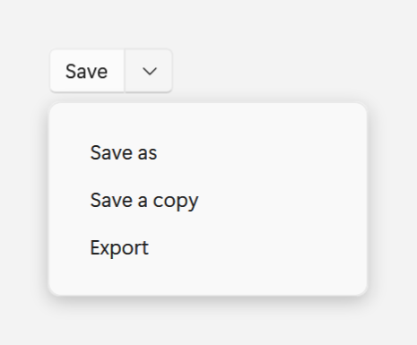
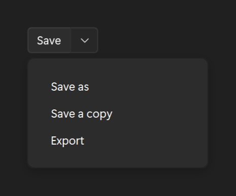

# SplitButton

## Description

Use SplitButton when there is one default action plus alternate actions in the flyout.

| Light | Dark |
| --- | --- |
|  |  |

### Open flyout





## Example usage

```xml
<fluence:SplitButton Content="Save" Command="{Binding SaveCommand}">
    <fluence:SplitButton.Flyout>
        <StackPanel>
            <fluence:Button Content="Save as" Command="{Binding SaveAsCommand}" />
            <fluence:Button Content="Export" Command="{Binding ExportCommand}" />
        </StackPanel>
    </fluence:SplitButton.Flyout>
</fluence:SplitButton>
```

The main region invokes `SaveCommand`; bind the alternate commands on the page's data context.


```csharp
var action = new Fluence.Wpf.Controls.SplitButton { Content = "Save" };
```


## Key properties

| Property | Default | Purpose |
| --- | --- | --- |
| `Appearance` | `Standard` | Sets the visual emphasis. |
| `Command` | `null` | Command invoked by the primary action. |
| `CommandParameter` | `null` | Parameter passed to the command. |
| `Flyout` | `null` | Content shown by the secondary action. |
| `CornerRadius` | `4` | Rounds the main surface. |
| `DropdownCornerRadius` | `8` | Rounds the flyout surface. |

## State and behavior

The main region performs the default action while the arrow opens alternate actions.

## Events

`Click` is raised for the primary action.

## Related

- [C# how-to guide](../how-to/dialogs-and-feedback.md)

## Reference

- [C# API reference](../api/Fluence.Wpf.Controls/SplitButton.md)
- [Gallery XAML source](../../Fluence.Wpf.Demo/Pages/GalleryButtonsPage.xaml)
- [Gallery C# source](../../Fluence.Wpf.Demo/Pages/GalleryButtonsPage.xaml.cs)
- [Control source](../../Fluence.Wpf/Controls/SplitButton.cs)
- [Control catalog](../controls.md)
