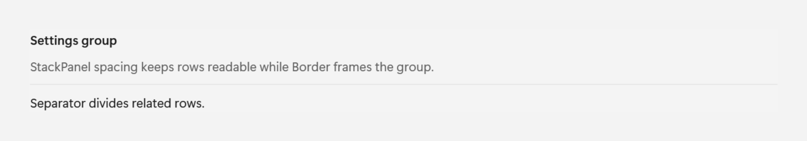
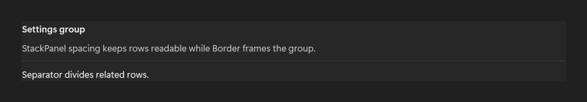

# StackPanel

## Description

StackPanel extends the WPF `StackPanel` with uniform spacing between children.

| Light | Dark |
| --- | --- |
|  |  |

## Example usage

```xml
<fluence:StackPanel Spacing="10">
    <fluence:Button Content="New" />
    <fluence:Button Content="Open" />
    <fluence:Button Content="Save" />
</fluence:StackPanel>
```

```csharp
var panel = new Fluence.Wpf.Controls.StackPanel { Spacing = 10 };
```

## Key properties

| Property | Default | Purpose |
| --- | --- | --- |
| `Spacing` | `0` | Space between consecutive children. |
| `Orientation` | WPF default | Chooses horizontal or vertical arrangement. |

## State and behavior

Spacing changes the gaps between stacked children; orientation changes the layout direction.

The spacing is applied between children; use `Orientation` to change direction.

## Related

- [C# how-to guide](../how-to/inputs-and-data.md)

## Reference

- [C# API reference](../api/Fluence.Wpf.Controls/StackPanel.md)
- [Gallery XAML source](../../Fluence.Wpf.Demo/Pages/GalleryLayoutPage.xaml)
- [Gallery C# source](../../Fluence.Wpf.Demo/Pages/GalleryLayoutPage.xaml.cs)
- [Control source](../../Fluence.Wpf/Controls/StackPanel.cs)
- [Control catalog](../controls.md)
