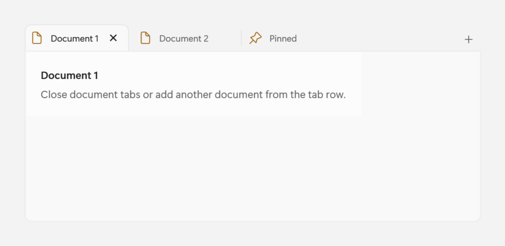
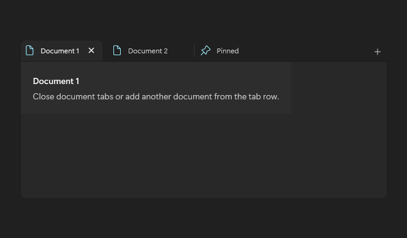
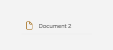
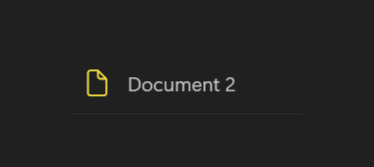

# TabView

## Description

TabView extends the WPF `TabControl` with document-style tabs and add and close requests.

| Light | Dark |
| --- | --- |
|  |  |

## Example usage

```xml
<fluence:TabView>
    <fluence:TabViewItem Header="Document 1" IsSelected="True" />
    <fluence:TabViewItem Header="Document 2" />
</fluence:TabView>
```

```csharp
var tabs = new Fluence.Wpf.Controls.TabView();
tabs.Items.Add(new Fluence.Wpf.Controls.TabViewItem { Header = "Document 1" });
```

## Key properties

| Property | Default | Purpose |
| --- | --- | --- |
| `IsAddTabButtonVisible` | `true` | Shows the add button. |
| `TabWidthMode` | `SizeToContent` | Controls how tab widths are assigned. |
| `CloseButtonOverlayMode` | `Auto` | Controls close button presentation. |

## State and behavior

Selection changes the visible document; add and close requests are handled by the application.

## Events

`AddTabButtonClick` requests a new tab. `TabCloseRequested` reports a close request; the application removes the item when appropriate.

## Related

- [C# how-to guide](../how-to/navigation-and-tabs.md)

## Parts

### TabViewItem {#tab-view-item}

#### Description {#tab-view-item-description}

TabViewItem is a document tab inside TabView. The screenshots show `TabViewItem` inside `TabView`.

Use it for a document or workspace tab inside TabView.

| Light | Dark |
| --- | --- |
|  |  |

#### Example usage {#tab-view-item-example-usage}

```xml
<fluence:TabView>
    <fluence:TabViewItem Header="Document 1" IsSelected="True" />
    <fluence:TabViewItem Header="Document 2" IsClosable="False" />
</fluence:TabView>
```

#### State and behavior {#tab-view-item-state-and-behavior}

Selected and inactive tabs have different presentations; IsClosable controls the close affordance.

#### Reference {#tab-view-item-reference}

- [C# API reference](../api/Fluence.Wpf.Controls/TabViewItem.md)
- [Gallery XAML source](../../Fluence.Wpf.Demo/Pages/GalleryTabsPage.xaml)
- [Gallery C# source](../../Fluence.Wpf.Demo/Pages/GalleryTabsPage.xaml.cs)
- [Control source](../../Fluence.Wpf/Controls/TabViewItem.cs)
- [Control catalog](../controls.md)

## Additional behavior

[NavigationView](navigation-view.md) derives from `Selector`. Put its page host in `NavigationView.Content`, because an unnamed child enters the item collection. The application controls its navigation history. [TabView](tab-view.md) extends WPF `TabControl`; a close request does not remove the item for you. See [navigation and tabs](../how-to/navigation-and-tabs.md).

In `TabView`, the trailing arrow from the last visible, enabled, focusable header reaches the visible enabled add button; the reverse arrow returns to the header. When no header can receive keyboard focus, Tab reaches the add button directly. Tab then leaves the strip. Arrow navigation and overflow-button glyphs follow right-to-left layout. Ctrl+F4 requests closure of the selected closable tab from its header or content, unless the content handles the key first. Selection and layout changes keep the selected header visible within the strip. A header wider than the viewport aligns its physical leading edge with the viewport's leading edge.

## Reference

- [C# API reference](../api/Fluence.Wpf.Controls/TabView.md)
- [Gallery XAML source](../../Fluence.Wpf.Demo/Pages/GalleryTabsPage.xaml)
- [Gallery C# source](../../Fluence.Wpf.Demo/Pages/GalleryTabsPage.xaml.cs)
- [Control source](../../Fluence.Wpf/Controls/TabView.cs)
- [Control catalog](../controls.md)
