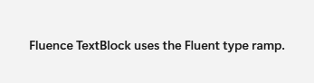
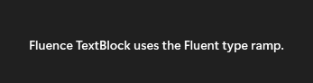

# TextBlock

## Description

Fluence TextBlock presents text using the Fluent typography ramp.

Use it for read-only text that should follow the Fluent typography ramp.

| Light | Dark |
| --- | --- |
|  |  |

## Example usage

```xml
<fluence:TextBlock Text="Section heading" Typography="Subtitle" />
```


```csharp
var label = new Fluence.Wpf.Controls.TextBlock { Text = "Hello" };
```


## Key properties

| Property | Default | Purpose |
| --- | --- | --- |
| `Text` | Empty string | Text to display. |
| `Typography` | `Body` | Selects a Fluent typography role. |
| `TextWrapping` | `NoWrap` | Controls line wrapping. |
| `TextTrimming` | `None` | Controls trimming when text overflows. |

## State and behavior

Typography resources change the text style; theme changes update its foreground.

## Parts

### TextBlockExtensions {#text-block-extensions}

#### Description {#text-block-extensions-description}

TextBlockExtensions adds Fluent typography and related attached properties to native text. The screenshots show `TextBlockExtensions` inside `TextBlock`.

The gallery image shows the typography ramp on a native TextBlock. It does not isolate an attached TextBlockExtensions property.

| Light | Dark |
| --- | --- |
|  |  |

#### Example usage {#text-block-extensions-example-usage}

```xml
<TextBlock Text="Section heading"
           fluence:TextBlockExtensions.Typography="Subtitle" />
```

#### State and behavior {#text-block-extensions-state-and-behavior}

Attached typography and selection properties change native text presentation.

#### Reference {#text-block-extensions-reference}

- [C# API reference](../api/Fluence.Wpf.Controls/TextBlockExtensions.md)
- [Gallery XAML source](../../Fluence.Wpf.Demo/Pages/GalleryTypographyPage.xaml)
- [Gallery C# source](../../Fluence.Wpf.Demo/Pages/GalleryTypographyPage.xaml.cs)
- [Control source](../../Fluence.Wpf/Controls/TextBlockExtensions.cs)
- [Control catalog](../controls.md)

## Additional behavior

Typography styles such as `BodyTextBlockStyle` and `TitleLargeTextBlockStyle` are application resources. See [theming](../theming.md).

## Related

- [C# how-to guide](../how-to/inputs-and-data.md)

## Reference

- [C# API reference](../api/Fluence.Wpf.Controls/TextBlock.md)
- [Gallery XAML source](../../Fluence.Wpf.Demo/Pages/GalleryTypographyPage.xaml)
- [Gallery C# source](../../Fluence.Wpf.Demo/Pages/GalleryTypographyPage.xaml.cs)
- [Control source](../../Fluence.Wpf/Controls/TextBlock.cs)
- [Control catalog](../controls.md)
