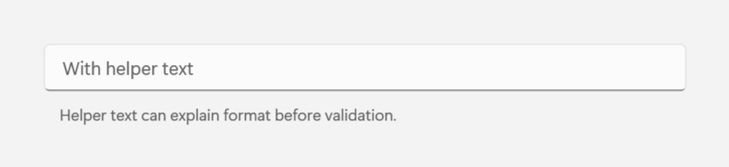
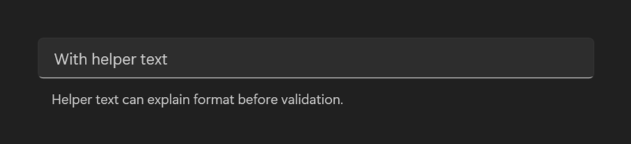
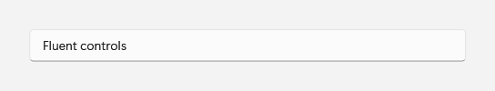
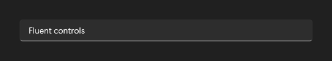

# TextBox

## Description

TextBox extends the WPF `TextBox` with Fluent placeholder, helper, clear-button, and validation presentation.

| Light | Dark |
| --- | --- |
|  |  |

### Text entered {#captured-state-changes}




## Example usage

```xml
<fluence:TextBox PlaceholderText="With helper text" />
```

```csharp
var field = new Fluence.Wpf.Controls.TextBox { PlaceholderText = "With helper text" };
```

## Key properties

| Property | Default | Purpose |
| --- | --- | --- |
| `PlaceholderText` | Empty string | Text displayed when the field is empty. |
| `HelperText` | Empty string | Guidance shown below the field. |
| `ValidationState` | `None` | Selects the validation presentation. |
| `ValidationMessage` | Empty string | Message associated with validation state. |
| `ClearButtonEnabled` | `true` | Enables the clear button. |

## State and behavior

Focus, text entry, helper text, and validation states change the field presentation.

## Events

The inherited `TextChanged` event reports changes to the text.

## Related

- [C# how-to guide](../how-to/inputs-and-data.md)

### Theme resource roles

`TextControlElevationBorderFocusedBrush` paints the rounded focus border for TextBox, PasswordBox, and NumberBox. The stock AutoSuggestBox template receives the same focus treatment through its embedded Fluence TextBox, as do the ColorPicker Hex, RGB, HSV, and alpha editors. Editable ComboBox uses the same resources on its field border. Its accent band follows the border's corner radius. `TextControlBorderThemeThicknessFocused` is `1,1,1,2` in Light and Dark and `2` on every side in High Contrast. Use both resources dynamically in custom templates so an already focused control follows theme and accent changes. Keep content insets independent of the focused stroke thickness to avoid moving the editor.

## Platform behavior

### Text input focus

`TextBox`, the styled native `PasswordBox`, `NumberBox`, editable `ComboBox`, the embedded TextBox in `AutoSuggestBox`, and the ColorPicker Hex, RGB, HSV, and alpha editors paint the focus accent inside their rounded border. Light and Dark use a 2-DIP bottom stroke; High Contrast uses a 2-DIP outline on all sides. Changing the painted focus stroke leaves content insets unchanged. The normal TextBox clear-button visibility still follows focus and text. TextBox validation keeps its status color and takes precedence over the accent.

### Selected text

`TextBox`, `PasswordBox`, and `NumberBox`'s native text editor use WPF's default translucent selection overlay and WPF selected-text foreground behavior. The `net472` baseline cannot use the `SelectionTextBrush` property added in .NET Framework 4.8. Published selection color roles alone do not guarantee identical WinUI selected-text rendering; see [known issues](https://github.com/sintaxasn/Fluence.Wpf/blob/main/KNOWN_ISSUES.md#selected-text-rendering-in-native-wpf-editors).

## Reference

- [C# API reference](../api/Fluence.Wpf.Controls/TextBox.md)
- [Gallery XAML source](../../Fluence.Wpf.Demo/Pages/GalleryInputsPage.xaml)
- [Gallery C# source](../../Fluence.Wpf.Demo/Pages/GalleryInputsPage.xaml.cs)
- [Control source](../../Fluence.Wpf/Controls/TextBox.cs)
- [Control catalog](../controls.md)
