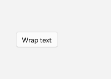
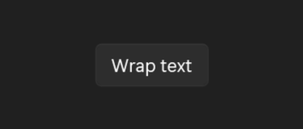

# ToggleButton

## Description

Use ToggleButton when a command switches a state on or off and should look pressed while active.

| Light | Dark |
| --- | --- |
|  |  |

## Example usage

```xml
<fluence:ToggleButton Content="Wrap text" IsChecked="True" />
```


```csharp
var toggle = new Fluence.Wpf.Controls.ToggleButton { Content = "Pin", IsChecked = true };
```


## Key properties

| Property | Default | Purpose |
| --- | --- | --- |
| `IsChecked` | `false` | Current checked state. |
| `Appearance` | `Standard` | Sets the visual emphasis. |
| `CornerRadius` | `4` | Rounds the surface. |

## State and behavior

IsChecked controls the persistent pressed presentation; the gallery also demonstrates unchecked and disabled states.

## Events

`Checked` and `Unchecked` report state changes.

## Related

- [C# how-to guide](../how-to/inputs-and-data.md)

## Reference

- [C# API reference](../api/Fluence.Wpf.Controls/ToggleButton.md)
- [Gallery XAML source](../../Fluence.Wpf.Demo/Pages/GalleryButtonsPage.xaml)
- [Gallery C# source](../../Fluence.Wpf.Demo/Pages/GalleryButtonsPage.xaml.cs)
- [Control source](../../Fluence.Wpf/Controls/ToggleButton.cs)
- [Control catalog](../controls.md)
