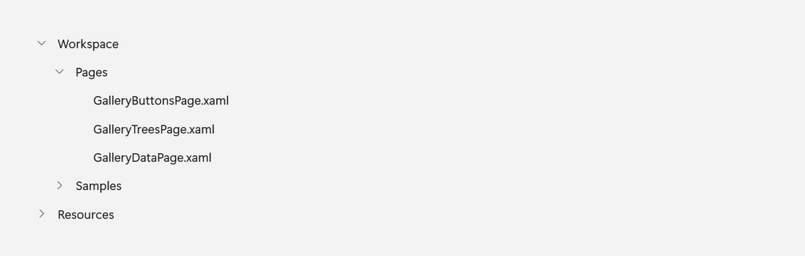
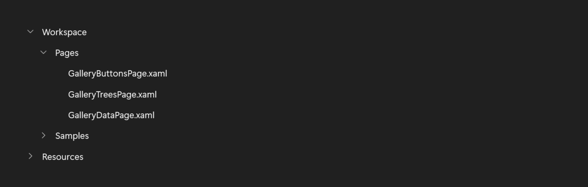
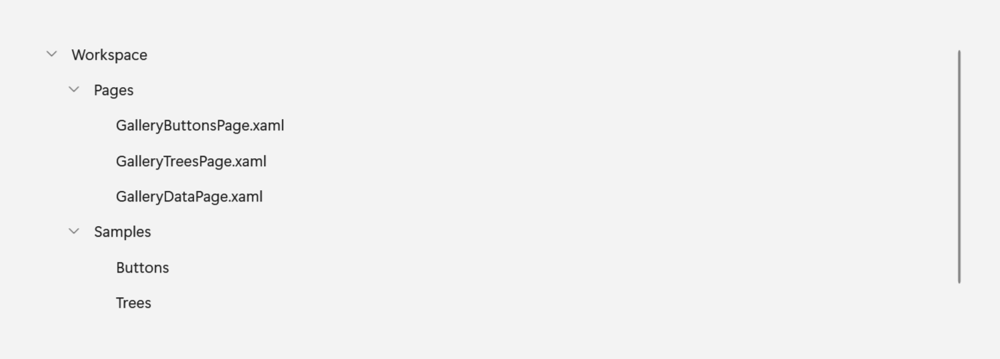
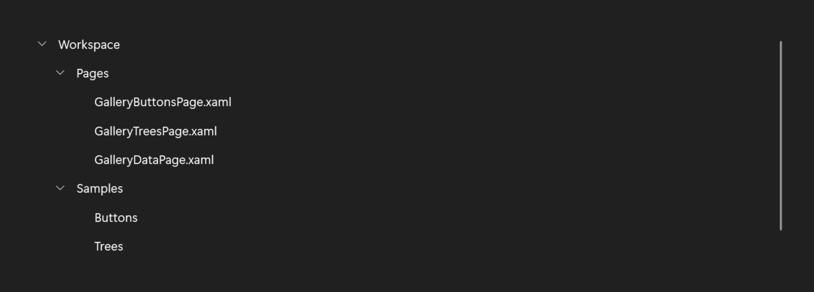

# TreeView

## Description

TreeView extends the WPF `TreeView` to display hierarchical items with optional multiple selection.

| Light | Dark |
| --- | --- |
|  |  |

### Expanded nodes





## Example usage

```xml
<fluence:TreeView>
    <fluence:TreeViewItem Header="Workspace" IsExpanded="True">
        <fluence:TreeViewItem Header="Pages" />
    </fluence:TreeViewItem>
</fluence:TreeView>
```

```csharp
var tree = new Fluence.Wpf.Controls.TreeView();
tree.Items.Add(new Fluence.Wpf.Controls.TreeViewItem { Header = "Workspace" });
```

## Key properties

| Property | Default | Purpose |
| --- | --- | --- |
| `SelectionMode` | `Single` | Selects single, multiple, or no selection. |
| `SelectedItems` | Empty collection | Contains selected items in multiple-selection scenarios. |

## State and behavior

Nodes expand and collapse; selection can be single or multiple.

The default template uses physical scrolling. Single and None selection can opt into virtualization; the shipped Multiple template keeps physical scrolling because selection depends on realized containers. Bind selection and expansion state to the model when using recycling.

## Events

Use the inherited `SelectedItemChanged` event for WPF single-selection changes.

## Related

- [C# how-to guide](../how-to/navigation-and-tabs.md)

## Parts

### TreeViewItem {#tree-view-item}

#### Description {#tree-view-item-description}

TreeViewItem represents an expandable node inside TreeView. The screenshots show `TreeViewItem` inside `TreeView`.

Use it for a node within a TreeView hierarchy.

See the parent control captures above for this part in context.

#### Example usage {#tree-view-item-example-usage}

```xml
<fluence:TreeView>
    <fluence:TreeViewItem Header="Workspace" IsExpanded="True">
        <fluence:TreeViewItem Header="Pages" />
    </fluence:TreeViewItem>
</fluence:TreeView>
```

#### State and behavior {#tree-view-item-state-and-behavior}

IsExpanded reveals children; selection and pointer states change the row.

#### Reference {#tree-view-item-reference}

- [C# API reference](../api/Fluence.Wpf.Controls/TreeViewItem.md)
- [Gallery XAML source](../../Fluence.Wpf.Demo/Pages/GalleryTreesPage.xaml)
- [Gallery C# source](../../Fluence.Wpf.Demo/Pages/GalleryTreesPage.xaml.cs)
- [Control source](../../Fluence.Wpf/Controls/TreeViewItem.cs)
- [Control catalog](../controls.md)

## Additional behavior

`TreeView` retains physical scrolling by default. With `SelectionMode="Single"` or `"None"`, opt in using `VirtualizingPanel.IsVirtualizing="True"`; `VirtualizingPanel.VirtualizationMode="Recycling"` can reuse containers. Keep selection and expansion state in model-backed item bindings when it must survive recycling. `Multiple` mode uses physical scrolling in the shipped template even when logical scrolling and a virtualizing panel are requested, because checked selection and parent tri-state currently depend on realized containers. A fully custom control template is responsible for its own behavior. See the [tree-selection limitations](../../KNOWN_ISSUES.md#tree-selection-and-unrealized-data-bound-branches).

## Reference

- [C# API reference](../api/Fluence.Wpf.Controls/TreeView.md)
- [Gallery XAML source](../../Fluence.Wpf.Demo/Pages/GalleryTreesPage.xaml)
- [Gallery C# source](../../Fluence.Wpf.Demo/Pages/GalleryTreesPage.xaml.cs)
- [Control source](../../Fluence.Wpf/Controls/TreeView.cs)
- [Control catalog](../controls.md)
