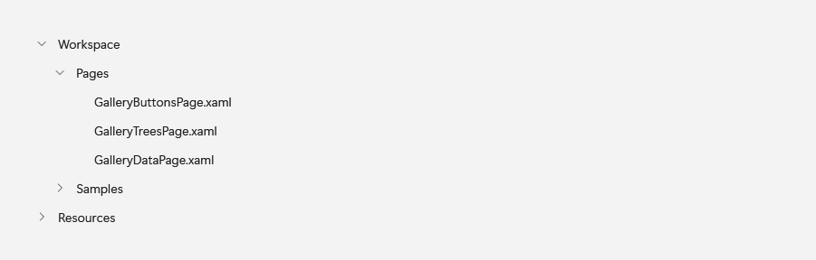
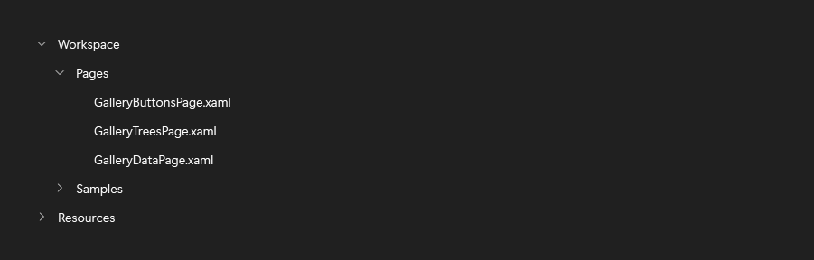
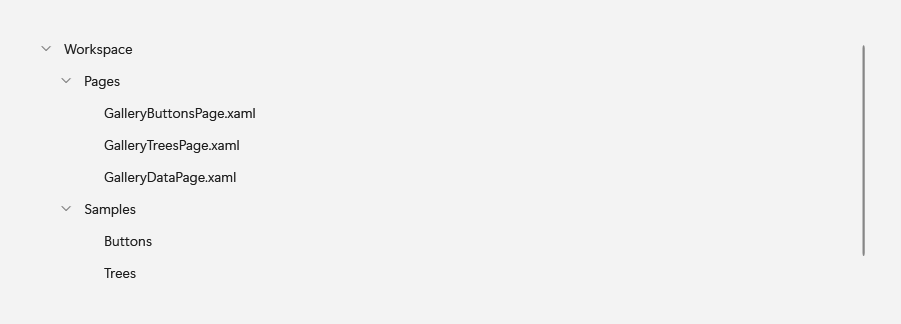
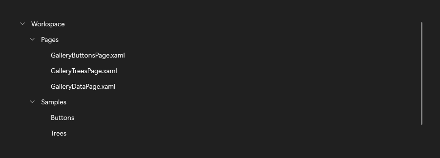

# TreeView

## Description

TreeView extends the WPF `TreeView` to display hierarchical items with optional multiple selection.

| Light | Dark |
| --- | --- |
|  |  |

### Expanded nodes





## Example usage

```xml
<fluence:TreeView>
    <fluence:TreeViewItem Header="Workspace" IsExpanded="True">
        <fluence:TreeViewItem Header="Pages" />
    </fluence:TreeViewItem>
</fluence:TreeView>
```

```csharp
var tree = new Fluence.Wpf.Controls.TreeView();
tree.Items.Add(new Fluence.Wpf.Controls.TreeViewItem { Header = "Workspace" });
```

## Key properties

| Property | Default | Purpose |
| --- | --- | --- |
| `SelectionMode` | `Single` | Selects single, multiple, or no selection. |
| `SelectedItems` | Empty collection | Stays the same list instance while the tree updates its contents. In Multiple mode it contains the checked items represented by current containers. |

## State and behavior

In Multiple mode, check a branch to apply the same state to its descendants. Collapsed data-bound descendants receive a pending check or uncheck when WPF creates their containers. Until then, their bound values and `SelectedItems` can still omit the pending state. If a command needs the full checked hierarchy before expansion, keep that state in the data model. [Selection of unrealized descendants](https://github.com/sintaxasn/Fluence.Wpf/blob/main/KNOWN_ISSUES.md#treeview-selection-can-omit-unrealized-descendants)

## Events

Use the inherited `SelectedItemChanged` event for WPF single-selection changes.

## Related

- [C# how-to guide](../how-to/navigation-and-tabs.md)

## Parts

### TreeViewItem {#tree-view-item}

#### Description {#tree-view-item-description}

TreeViewItem represents an expandable node inside TreeView. The screenshots show `TreeViewItem` inside `TreeView`.

Use it for a node within a TreeView hierarchy.

See the parent control captures above for this part in context.

#### Example usage {#tree-view-item-example-usage}

```xml
<fluence:TreeView>
    <fluence:TreeViewItem Header="Workspace" IsExpanded="True">
        <fluence:TreeViewItem Header="Pages" />
    </fluence:TreeViewItem>
</fluence:TreeView>
```

#### State and behavior {#tree-view-item-state-and-behavior}

`IsExpanded` reveals children. In Multiple mode, `IsSelectionChecked` can be checked, unchecked, or indeterminate when a parent has mixed descendants.

#### Reference {#tree-view-item-reference}

- [C# API reference](../api/Fluence.Wpf.Controls/TreeViewItem.md)
- [Gallery XAML source](../../Fluence.Wpf.Demo/Pages/GalleryTreesPage.xaml)
- [Gallery C# source](../../Fluence.Wpf.Demo/Pages/GalleryTreesPage.xaml.cs)
- [Control source](../../Fluence.Wpf/Controls/TreeViewItem.cs)
- [Control catalog](../controls.md)

## Additional behavior

`TreeView` uses physical scrolling by default. With `SelectionMode="Single"` or `"None"`, set `VirtualizingPanel.IsVirtualizing="True"` to opt in. Set `VirtualizingPanel.VirtualizationMode="Recycling"` to reuse containers. Bind selection and expansion to the data model if they must survive recycling. The shipped Multiple template keeps physical scrolling because checked selection and parent state depend on realized containers. [Multiple-selection virtualization limit](https://github.com/sintaxasn/Fluence.Wpf/blob/main/KNOWN_ISSUES.md#treeview-multiple-selection-can-realize-every-root-item)

## Reference

- [C# API reference](../api/Fluence.Wpf.Controls/TreeView.md)
- [Gallery XAML source](../../Fluence.Wpf.Demo/Pages/GalleryTreesPage.xaml)
- [Gallery C# source](../../Fluence.Wpf.Demo/Pages/GalleryTreesPage.xaml.cs)
- [Control source](../../Fluence.Wpf/Controls/TreeView.cs)
- [Control catalog](../controls.md)
