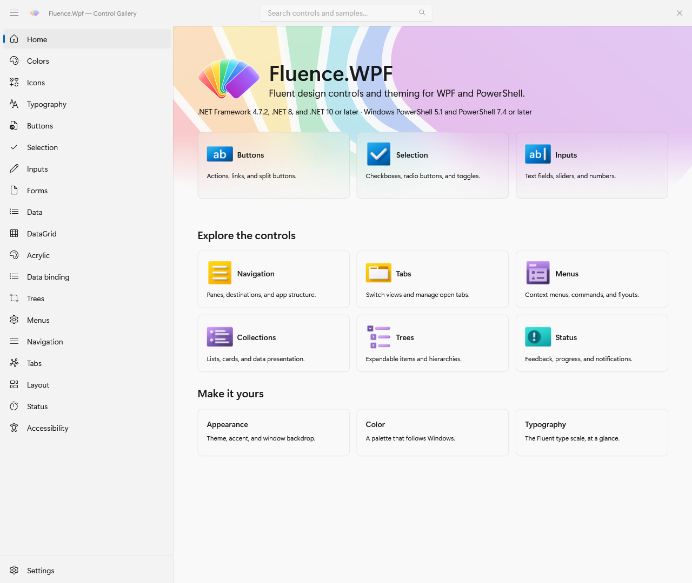
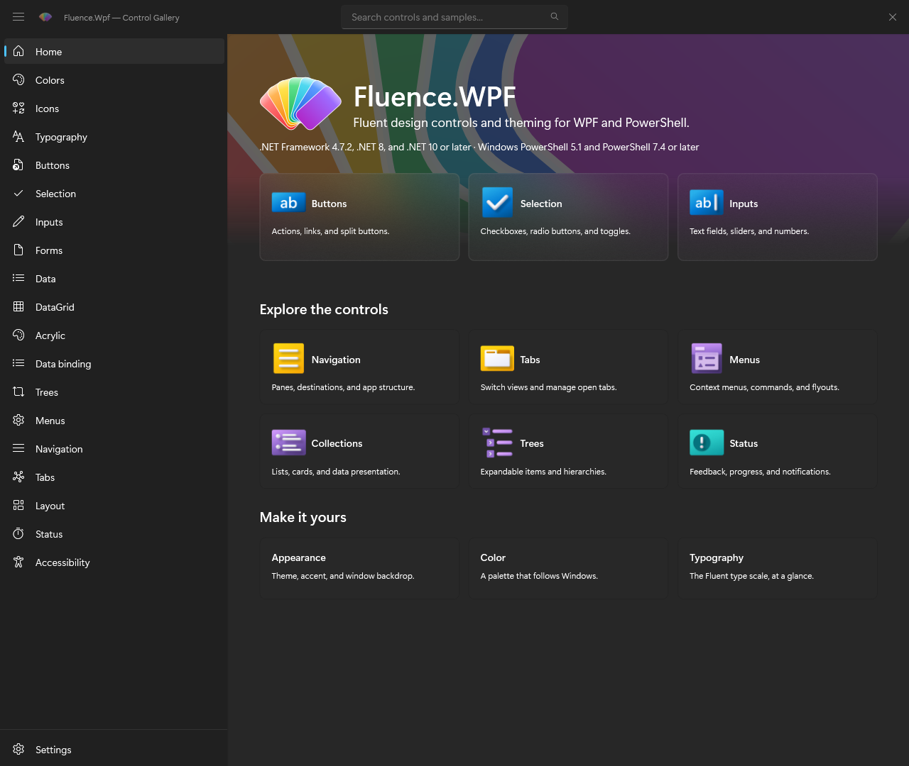

# Running the Gallery

The Fluence.Wpf Gallery is the quickest way to inspect controls, theme states, and working XAML and C# examples. Its pages demonstrate window chrome, navigation, inputs, dialogs, and layout. The [control catalog](../controls.md) links individual examples.

## Download a release

Open [Fluence.Wpf releases](https://github.com/sintaxasn/Fluence.Wpf/releases) and choose a release with a Gallery ZIP whose name starts with `Fluence.Wpf.Demo-v`. Check the target framework in the asset name, extract the ZIP, and run the Gallery executable. Use the runtime requirements and instructions for the selected release.

## Build from source

Clone the repository and build the Gallery project for a framework installed on your Windows machine:

```powershell
git clone https://github.com/sintaxasn/Fluence.Wpf.git
cd Fluence.Wpf
dotnet build Fluence.Wpf.Demo/Fluence.Wpf.Demo.csproj -c Release -f net10.0-windows10.0.26100.0
dotnet run --project Fluence.Wpf.Demo/Fluence.Wpf.Demo.csproj -c Release -f net10.0-windows10.0.26100.0
```

The Gallery also targets `net472`; select that target if you are developing with .NET Framework 4.7.2. Its project source is in [`Fluence.Wpf.Demo`](../../Fluence.Wpf.Demo/). Browse the page XAML and code-behind beside the running example, or follow the source links on a control guide. Build and run the app on Windows, where WPF and the Windows visual effects are available.

The home page uses a themed Fluence illustration with acrylic in the featured row above the solid control catalog. High Contrast uses solid surfaces.





## Compare acrylic material

Open **Acrylic** to compare the fixed direct brush with a host that follows a theme recipe. Switch between Default and Base or force the solid fallback. The popup sample shows the solid fallback when the source lives in the main window. [AcrylicElement guide](../controls/acrylic-element.md)

Open **Colors > Background** to compare the Default and Base recipes in **Acrylic Background** and **Accent Acrylic Background**. Choose a different accent in **Settings** to see the accent recipes update. The adjacent swatches show the solid paint tokens.

## Compare Mica colors

The Colors gallery's **Layer on Mica Base Alt** example lets the existing window backdrop show through the sample's overlay brushes. Its Tertiary swatch stays opaque.

The **Mica Background** swatches show the solid Base and Base Alt fallback brushes. Their copy actions provide the window settings `SystemBackdropType="Mica"` and `SystemBackdropType="Tabbed"`. See [Windows and backdrop support](requirements.md#windows-and-backdrop-support).
