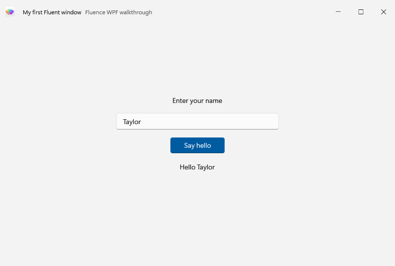
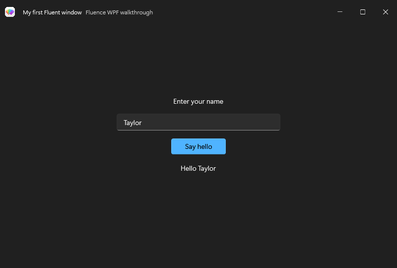

# Basic walkthrough

Create your first Fluence window in the WPF project from [installation](installation.md). The example uses the project namespace `MyApp`; replace it throughout with your own project's namespace. It works with C# 7.3 and later.

## Initialize the application

Remove `StartupUri` from `App.xaml` so the window opens after theme initialization:

```xml
<Application x:Class="MyApp.App"
             xmlns="http://schemas.microsoft.com/winfx/2006/xaml/presentation"
             xmlns:x="http://schemas.microsoft.com/winfx/2006/xaml" />
```

In `App.xaml.cs`, apply the theme and show the window:

```csharp
using System.Windows;
using Fluence.Wpf;

namespace MyApp
{
    public partial class App : Application
    {
        protected override void OnStartup(StartupEventArgs e)
        {
            base.OnStartup(e);
            ApplicationThemeManager.Apply(ApplicationTheme.Auto);
            MainWindow = new MainWindow();
            MainWindow.Show();
        }
    }
}
```

`Auto` follows the Windows app theme and uses the system accent by default. The manager loads Fluence control templates; do not merge `Generic.xaml` yourself.

## Declare the window and its layout

Replace `MainWindow.xaml` with this window. The `x:Class` must match the code-behind namespace and class.

```xml
<fluence:FluenceWindow x:Class="MyApp.MainWindow"
    xmlns="http://schemas.microsoft.com/winfx/2006/xaml/presentation"
    xmlns:x="http://schemas.microsoft.com/winfx/2006/xaml"
    xmlns:fluence="http://schemas.fluencewpf.com"
    Title="My first Fluent window" Width="800" Height="540"
    Background="{DynamicResource ApplicationBackgroundBrush}">
    <fluence:StackPanel Spacing="16" HorizontalAlignment="Center" VerticalAlignment="Center">
        <fluence:TextBlock Text="Enter your name" />
        <fluence:TextBox x:Name="NameInput" Width="330" />
        <fluence:Button Content="Say hello" Click="SayHello_Click" Appearance="Accent" />
        <fluence:TextBlock x:Name="ResultText" />
    </fluence:StackPanel>
</fluence:FluenceWindow>
```

The background uses `DynamicResource` so it follows theme changes. The StackPanel spaces its children by 16 device-independent pixels.

## Handle the click

Replace `MainWindow.xaml.cs` with:

```csharp
using System.Windows;
using Fluence.Wpf.Controls;

namespace MyApp
{
    public partial class MainWindow : FluenceWindow
    {
        public MainWindow()
        {
            InitializeComponent();
        }

        private void SayHello_Click(object sender, RoutedEventArgs e)
        {
            ResultText.Text = "Hello " + NameInput.Text;
        }
    }
}
```

Build and run the project from Visual Studio, or run `dotnet run --project YourApp.csproj` from a terminal. Enter a name and select **Say hello**.

## Continue

Try the [window and title bar guide](../how-to/window-and-title-bar.md), browse the [control catalog](../controls.md), or [run the Gallery](gallery.md). The website also provides an optional [standalone walkthrough sample](https://github.com/sintaxasn/Fluence.Wpf.Website/tree/main/samples/Fluence.Wpf.Docs.Walkthroughs), pinned to the bundled 0.9.1 package for reproducible captures. From the website repository root, build it with `pwsh ./samples/Fluence.Wpf.Docs.Walkthroughs/Build-Walkthroughs.ps1 -PackageSource ./samples/Fluence.Wpf.Docs.Walkthroughs/packages`, then run `dotnet run --project ./samples/Fluence.Wpf.Docs.Walkthroughs/Fluence.Wpf.Docs.Walkthroughs.csproj -c Release --no-build -- --example basic-usage`.

These screenshots show the standalone sample in light and dark themes:




