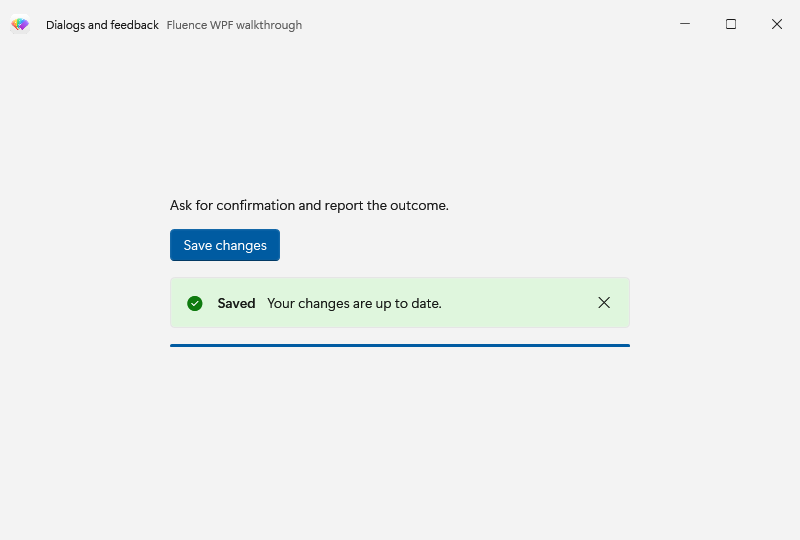
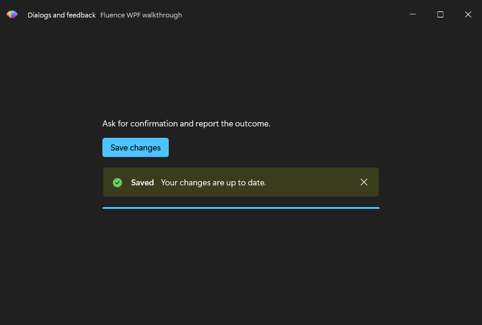

# Show a dialog and feedback

This standalone window asks the user to confirm a sample save, then shows the outcome inline with `InfoBar` and `ProgressBar`. Start with the [Basic walkthrough](../csharp/usage.md), then replace the window content and code-behind with the examples below. Replace `MyApp` with your project namespace.

## Declare the window

Replace the content inside the tutorial window with this layout. The standalone [DialogsAndFeedbackWindow.xaml](https://github.com/sintaxasn/Fluence.Wpf.Website/blob/main/samples/Fluence.Wpf.Docs.Walkthroughs/DialogsAndFeedbackWindow.xaml) contains the complete sample.

~~~xml
<fluence:StackPanel Width="460" HorizontalAlignment="Center" VerticalAlignment="Center" Spacing="16">
    <fluence:TextBlock Text="Ask for confirmation and report the outcome." />
    <fluence:Button Content="Save changes" Appearance="Accent" Click="Save_Click"
                    HorizontalAlignment="Left" />
    <fluence:InfoBar x:Name="SaveInfo" Title="Ready" Message="No changes saved yet."
                     IsOpen="True" />
    <fluence:ProgressBar x:Name="SaveProgress" Value="0" />
</fluence:StackPanel>
~~~

## Wire the interaction

[DialogsAndFeedbackWindow.xaml.cs](https://github.com/sintaxasn/Fluence.Wpf.Website/blob/main/samples/Fluence.Wpf.Docs.Walkthroughs/DialogsAndFeedbackWindow.xaml.cs) contains the code-behind. Replace `MainWindow.xaml.cs` with the following code and use the same namespace as your XAML.

~~~csharp
using System;
using System.Windows;
using System.Threading.Tasks;
using Fluence.Wpf;
using Fluence.Wpf.Controls;
namespace MyApp
{
    public partial class MainWindow : FluenceWindow
    {
        public MainWindow()
        {
            InitializeComponent();
        }

        private void Save_Click(object sender, RoutedEventArgs e)
        {
            _ = SaveAsync();
        }

        private async Task SaveAsync()
        {
            ContentDialog dialog = new ContentDialog()
            {
                Title = "Save changes?",
                Content = "Confirm the sample save action.",
                PrimaryButtonText = "Save",
                CloseButtonText = "Cancel",
            };
            try
            {
                ContentDialogResult result = await dialog.ShowAsync().ConfigureAwait(true);
                if (result is ContentDialogResult.Primary)
                {
                    ShowSaved();
                }
                else
                {
                    SaveInfo.Title = "Canceled";
                    SaveInfo.Message = "No changes were saved.";
                    SaveInfo.Severity = InfoBarSeverity.Informational;
                }
            }
            catch (InvalidOperationException ex)
            {
                ShowSaveError(ex.Message);
            }
            catch (OperationCanceledException ex)
            {
                ShowSaveError(ex.Message);
            }
        }

        private void ShowSaveError(string message)
        {
            SaveInfo.Title = "Save failed";
            SaveInfo.Message = message;
            SaveInfo.Severity = InfoBarSeverity.Error;
        }

        private void ShowSaved()
        {
            SaveProgress.Value = 100;
            SaveInfo.Title = "Saved";
            SaveInfo.Message = "Your changes are up to date.";
            SaveInfo.Severity = InfoBarSeverity.Success;
        }

    }
}
~~~

`fluence:StackPanel` spaces the button, `InfoBar`, and progress indicator. `Save_Click` starts `SaveAsync`, which awaits `ContentDialog.ShowAsync()` and uses the result to update feedback. Confirming sets progress to 100 and reports success; canceling reports that nothing was saved. `InvalidOperationException` and `OperationCanceledException` are caught and shown in `InfoBar`. The example changes UI state only and does not write a file.

## See the result

The screenshots show the standalone sample, which uses the same controls with its own window shell.

See [ContentDialog](../controls/content-dialog.md), [InfoBar](../controls/info-bar.md), and the [control catalog](../controls.md) for adjacent feedback controls.
