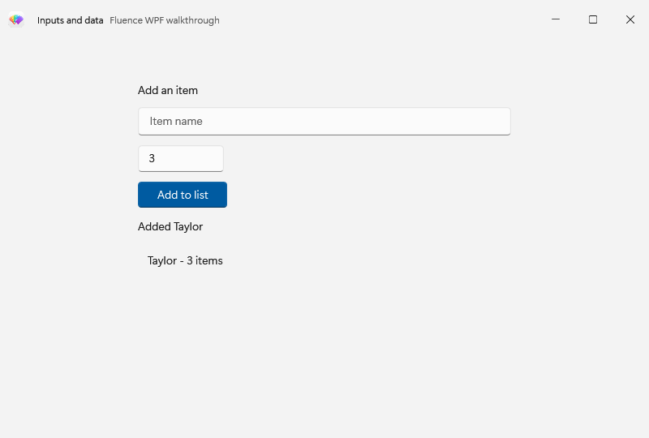
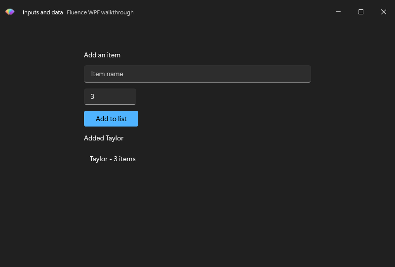

# Use inputs and data controls

This standalone form accepts an item name and quantity, validates them, and displays each submitted entry in a Fluence list. Start with the [Basic walkthrough](../csharp/usage.md), then replace the window content and code-behind with the examples below. Replace `MyApp` with your project namespace.

## Declare the window

Replace the existing content inside the `FluenceWindow` from the tutorial with the following layout. The standalone [InputsAndDataWindow.xaml](https://github.com/sintaxasn/Fluence.Wpf.Website/blob/main/samples/Fluence.Wpf.Docs.Walkthroughs/InputsAndDataWindow.xaml) contains the complete sample.

~~~xml
<fluence:StackPanel Width="460" HorizontalAlignment="Center" VerticalAlignment="Center" Spacing="12">
    <fluence:TextBlock Text="Add an item" />
    <fluence:TextBox x:Name="ItemName" PlaceholderText="Item name" />
    <fluence:NumberBox x:Name="Quantity" PlaceholderText="Quantity" Value="1" />
    <fluence:Button Content="Add to list" Click="AddItem_Click" Appearance="Accent"
                    HorizontalAlignment="Left" />
    <fluence:TextBlock x:Name="InputStatus" />
    <fluence:ListView x:Name="ItemsList" Height="140" ItemsSource="{Binding Entries}" />
</fluence:StackPanel>
~~~

## Wire the interaction

[InputsAndDataWindow.xaml.cs](https://github.com/sintaxasn/Fluence.Wpf.Website/blob/main/samples/Fluence.Wpf.Docs.Walkthroughs/InputsAndDataWindow.xaml.cs) contains the code-behind. Replace `MainWindow.xaml.cs` with the following code and use the same namespace as your XAML.

~~~csharp
using System;
using System.Collections.ObjectModel;
using System.Globalization;
using System.Windows;
using Fluence.Wpf.Controls;
namespace MyApp
{
    public partial class MainWindow : FluenceWindow
    {
        public ObservableCollection<string> Entries { get; } = new ObservableCollection<string>();

        public MainWindow()
        {
            InitializeComponent();
            DataContext = this;
        }

        private void AddItem_Click(object sender, RoutedEventArgs e)
        {
            AddItem();
        }

        private void AddItem()
        {
            if (string.IsNullOrWhiteSpace(ItemName.Text) || double.IsNaN(Quantity.Value) ||
                Quantity.Value <= 0 || Math.Abs(Quantity.Value - Math.Round(Quantity.Value, MidpointRounding.AwayFromZero)) > 0.000001)
            {
                InputStatus.Text = "Enter a name and a positive whole quantity.";
                return;
            }

            Entries.Add(ItemName.Text.Trim() + " - " + Quantity.Value.ToString("0", CultureInfo.CurrentCulture) + " items");
            InputStatus.Text = "Added " + ItemName.Text.Trim();
            ItemName.Text = string.Empty;
        }

    }
}
~~~

`fluence:StackPanel` gives the form fields a 12-pixel gap. `Entries` is an `ObservableCollection<string>`. The constructor assigns the window as `DataContext`, so `ItemsSource="{Binding Entries}"` resolves to that collection. WPF observes new entries and updates the list. `AddItem_Click` rejects an empty name, a nonnumber, and quantities that are not positive whole numbers. On success it adds a formatted entry and clears the name field.

## See the result

The screenshots show the standalone sample, which uses the same controls with its own window shell.

See the [control catalog](../controls.md) for other inputs and the [data binding gallery](https://github.com/sintaxasn/Fluence.Wpf/blob/main/Fluence.Wpf.Demo/Pages/GalleryDataBindingPage.xaml) for more collection examples.
