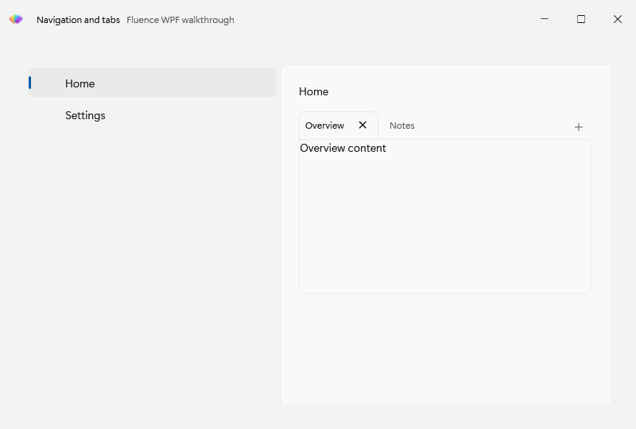
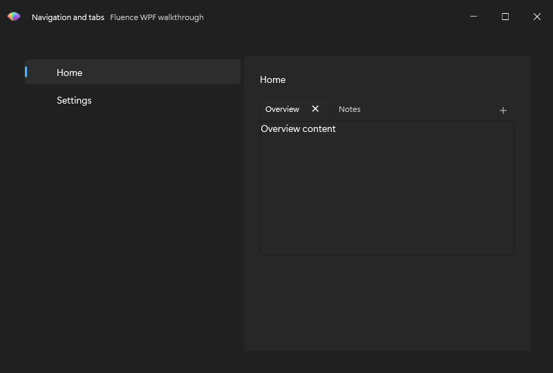

# Add navigation and tabs

This standalone window uses `NavigationView` for two destinations and `TabView` for work inside the selected destination. Start with the [Basic walkthrough](../csharp/usage.md), then replace the window content and code-behind with the examples below. Replace `MyApp` with your project namespace.

## Declare the window

Replace the content inside the tutorial window with this layout. The standalone [NavigationAndTabsWindow.xaml](https://github.com/sintaxasn/Fluence.Wpf.Website/blob/main/samples/Fluence.Wpf.Docs.Walkthroughs/NavigationAndTabsWindow.xaml) contains the complete sample.

~~~xml
<Grid Margin="32">
    <fluence:NavigationView x:Name="Navigation" IsPaneOpen="True"
                            SelectionChanged="Navigation_SelectionChanged">
        <fluence:NavigationView.Items>
            <fluence:NavigationViewItem Content="Home" />
            <fluence:NavigationViewItem Content="Settings" />
        </fluence:NavigationView.Items>
        <fluence:NavigationView.Content>
            <fluence:StackPanel Margin="24" Spacing="16">
                <fluence:TextBlock x:Name="DestinationText" Text="Home" />
                <fluence:TabView x:Name="Tabs" Height="230" IsAddTabButtonVisible="True"
                                 AddTabButtonClick="Tabs_AddTabButtonClick"
                                 TabCloseRequested="Tabs_TabCloseRequested">
                    <fluence:TabViewItem Header="Overview" Content="Overview content" />
                    <fluence:TabViewItem Header="Notes" Content="Notes content" />
                </fluence:TabView>
            </fluence:StackPanel>
        </fluence:NavigationView.Content>
    </fluence:NavigationView>
</Grid>
~~~

## Wire the interaction

[NavigationAndTabsWindow.xaml.cs](https://github.com/sintaxasn/Fluence.Wpf.Website/blob/main/samples/Fluence.Wpf.Docs.Walkthroughs/NavigationAndTabsWindow.xaml.cs) contains the code-behind. Replace `MainWindow.xaml.cs` with the following code and use the same namespace as your XAML.

~~~csharp
using System.Globalization;
using System.Windows;
using System.Windows.Controls;
using Fluence.Wpf;
using Fluence.Wpf.Controls;
namespace MyApp
{
    public partial class MainWindow : FluenceWindow
    {
        private int _nextTabNumber = 1;

        public MainWindow()
        {
            InitializeComponent();
            Navigation.SelectedIndex = 0;
        }

        private void Navigation_SelectionChanged(object sender, SelectionChangedEventArgs e)
        {
            if (Navigation.SelectedItem is NavigationViewItem item)
            {
                DestinationText.Text = item.Content?.ToString() ?? string.Empty;
            }
        }

        private void Tabs_AddTabButtonClick(object sender, RoutedEventArgs e)
        {
            TabViewItem tab = new TabViewItem()
            {
                Header = "New " + _nextTabNumber.ToString(CultureInfo.CurrentCulture),
                Content = "Content for new tab " + _nextTabNumber.ToString(CultureInfo.CurrentCulture),
            };
            _nextTabNumber++;
            _ = Tabs.Items.Add(tab);
            Tabs.SelectedItem = tab;
        }

        private void Tabs_TabCloseRequested(object sender, TabViewTabCloseRequestedEventArgs e)
        {
            Tabs.Items.Remove(e.Item);
        }
    }
}
~~~

`NavigationView.Items` holds the destinations. The content panel is assigned through `NavigationView.Content`; placing it as a bare child would put it among the selectable items. `fluence:StackPanel` spaces the destination label and tabs. `Navigation_SelectionChanged` copies the selected destination into `DestinationText`. The add button creates a new `TabViewItem`, adds it to `Tabs.Items`, and selects it. `TabCloseRequested` removes a tab when its close button is selected. This example changes the displayed destination label; it does not create a navigation history.

## See the result

The screenshots show the standalone sample, which uses the same controls with its own window shell.

See [NavigationView](../controls/navigation-view.md), [TabView](../controls/tab-view.md), and the [gallery shell](https://github.com/sintaxasn/Fluence.Wpf/blob/main/Fluence.Wpf.Demo/MainWindow.xaml) for a larger navigation example.
