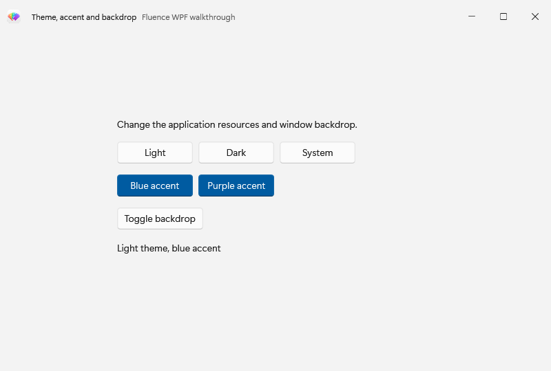
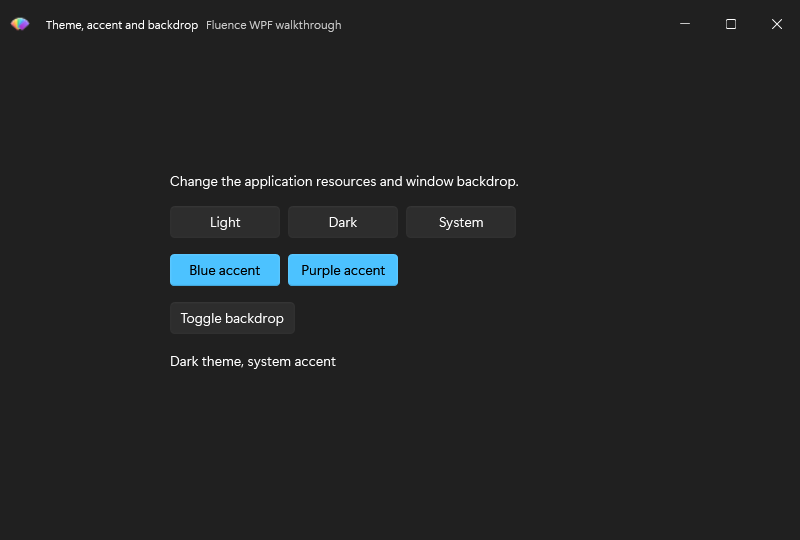
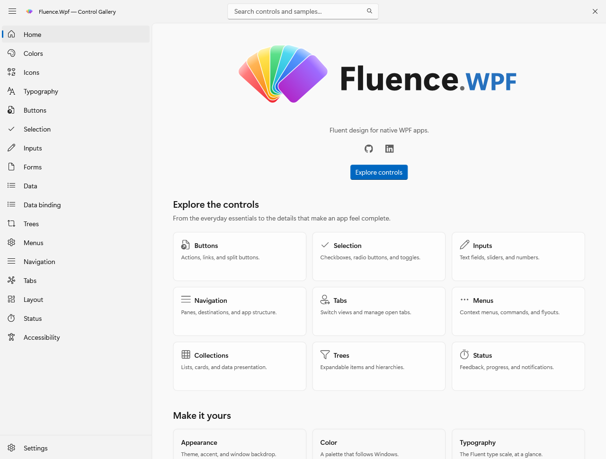
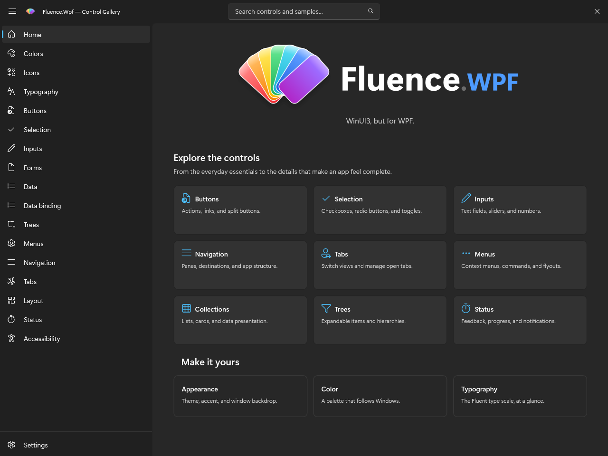
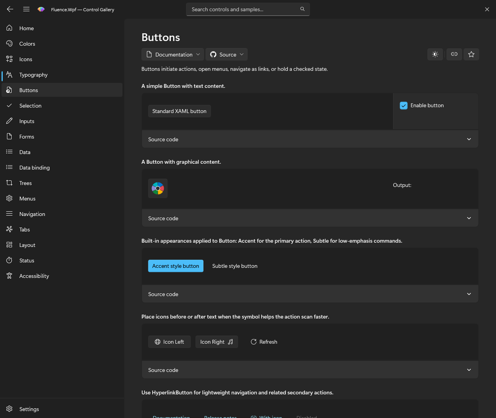
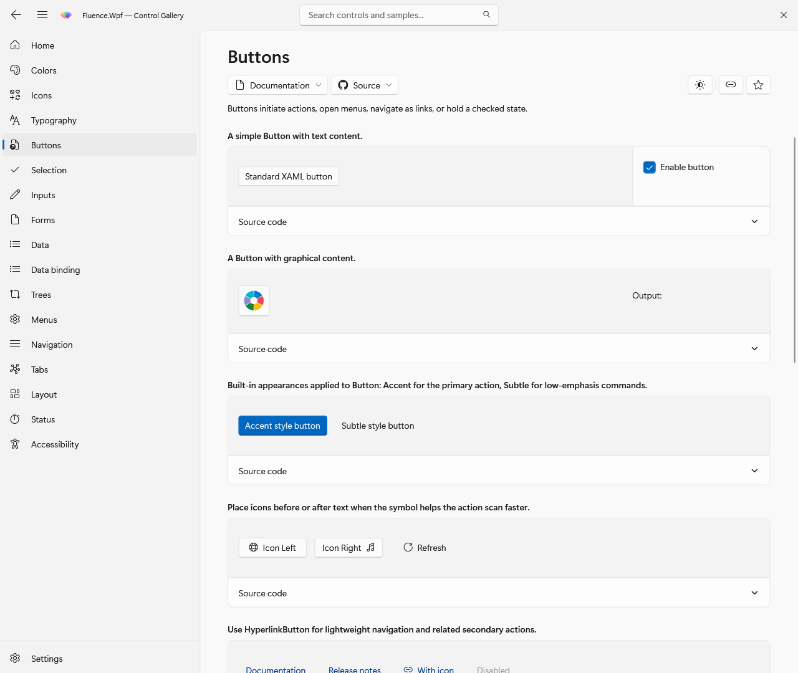
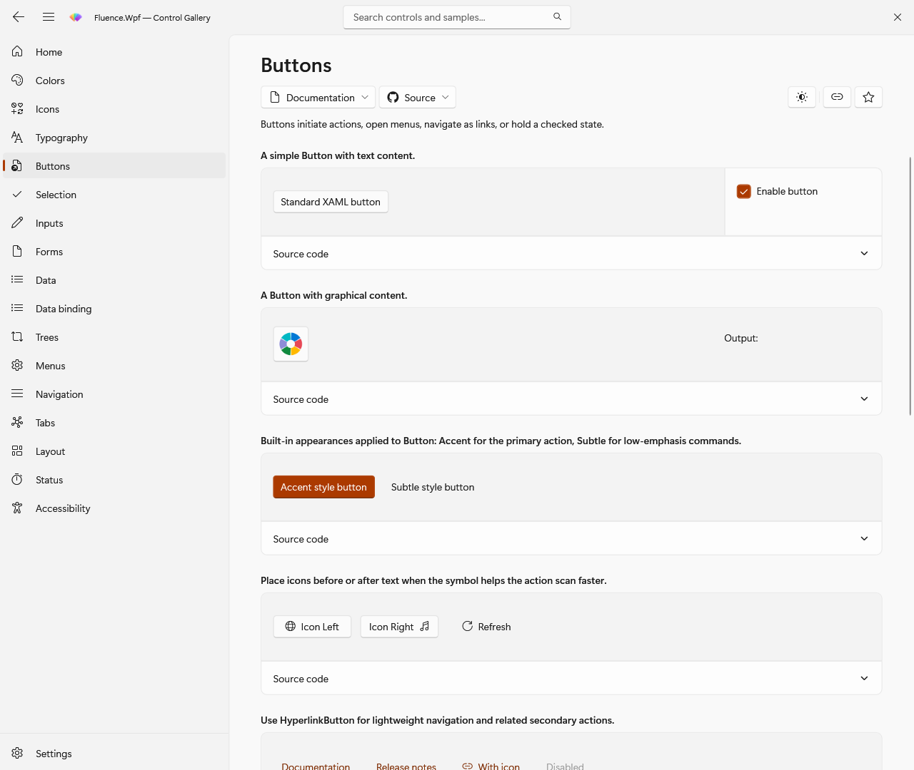

# Change theme, accent and backdrop

This standalone window lets you change the application theme and accent, then toggle this window's backdrop. Its buttons make the difference between application resources and a window property visible. Start with the [Basic walkthrough](../csharp/usage.md), then replace the window content and code-behind with the examples below. Replace `MyApp` with your project namespace.

## Declare the window

Replace the existing content inside the `FluenceWindow` from the tutorial with the following layout. The standalone [ThemeAndAccentWindow.xaml](https://github.com/sintaxasn/Fluence.Wpf.Website/blob/main/samples/Fluence.Wpf.Docs.Walkthroughs/ThemeAndAccentWindow.xaml) contains the complete sample.

~~~xml
<fluence:StackPanel Width="460" HorizontalAlignment="Center" VerticalAlignment="Center" Spacing="16">
    <fluence:TextBlock Text="Change the application resources and window backdrop." />
    <WrapPanel>
        <fluence:Button Content="Light" Click="Light_Click" Margin="0,0,8,0" />
        <fluence:Button Content="Dark" Click="Dark_Click" Margin="0,0,8,0" />
        <fluence:Button Content="System" Click="System_Click" />
    </WrapPanel>
    <WrapPanel>
        <fluence:Button Content="Blue accent" Appearance="Accent" Click="Blue_Click" Margin="0,0,8,0" />
        <fluence:Button Content="Purple accent" Appearance="Accent" Click="Purple_Click" />
    </WrapPanel>
    <fluence:Button Content="Toggle backdrop" Click="Backdrop_Click"
                    HorizontalAlignment="Left" />
    <fluence:TextBlock x:Name="ThemeStatus" />
</fluence:StackPanel>
~~~

## Wire the interaction

[ThemeAndAccentWindow.xaml.cs](https://github.com/sintaxasn/Fluence.Wpf.Website/blob/main/samples/Fluence.Wpf.Docs.Walkthroughs/ThemeAndAccentWindow.xaml.cs) contains the code-behind. Replace `MainWindow.xaml.cs` with the following code and use the same namespace as your XAML.

~~~csharp
using System.Windows;
using System.Windows.Media;
using Fluence.Wpf;
using Fluence.Wpf.Controls;
namespace MyApp
{
    public partial class MainWindow : FluenceWindow
    {
        public MainWindow()
        {
            InitializeComponent();
            ThemeStatus.Text = "Following system theme and accent";
        }

        private void Light_Click(object sender, RoutedEventArgs e)
        {
            ApplicationThemeManager.Apply(ApplicationTheme.Light);
            ThemeStatus.Text = "Light theme";
        }

        private void Dark_Click(object sender, RoutedEventArgs e)
        {
            ApplicationThemeManager.Apply(ApplicationTheme.Dark);
            ThemeStatus.Text = "Dark theme";
        }

        private void System_Click(object sender, RoutedEventArgs e)
        {
            ApplicationThemeManager.Apply(ApplicationTheme.Auto);
            ApplicationAccentColorManager.ApplySystemAccent();
            ThemeStatus.Text = "System theme and accent";
        }

        private void Blue_Click(object sender, RoutedEventArgs e)
        {
            ApplicationAccentColorManager.ApplyCustomAccent(Color.FromRgb(0x00, 0x78, 0xD4));
            ThemeStatus.Text = "Blue accent";
        }

        private void Purple_Click(object sender, RoutedEventArgs e)
        {
            ApplicationAccentColorManager.ApplyCustomAccent(Color.FromRgb(0x88, 0x57, 0xB7));
            ThemeStatus.Text = "Purple accent";
        }

        private void Backdrop_Click(object sender, RoutedEventArgs e)
        {
            SystemBackdropType = SystemBackdropType is WindowBackdropType.Mica
                ? WindowBackdropType.None
                : WindowBackdropType.Mica;
            ThemeStatus.Text = "Backdrop: " + SystemBackdropType;
        }
    }
}
~~~

`fluence:StackPanel` provides a 16-pixel gap between the controls and button rows. The Light, Dark, and System handlers call `ApplicationThemeManager.Apply`. The System handler also returns to the Windows accent with `ApplySystemAccent`; the blue and purple buttons pin a custom accent. Their `Appearance="Accent"` makes the active accent visible on both buttons as it changes. `Backdrop_Click` changes this window's `SystemBackdropType` between `Mica` and `None`. `ApplicationThemeManager.Apply` also accepts an optional backdrop argument; this example changes the window property directly.

## Pin a brand accent

By default a custom accent is a seed for a calculated palette. Use the `exact` option when the visible primary fill must match specified Light and Dark colors:

~~~csharp
Color light = Color.FromRgb(0x87, 0xAB, 0xC8);
Color dark = Color.FromRgb(0xAC, 0xCB, 0xDF);
ApplicationAccentColorManager.ApplyCustomAccent(light, dark, exact: true);
~~~

Call `ApplicationAccentColorManager.ApplySystemAccent()` to follow Windows again. High Contrast control colors continue to follow system roles.

## Add per-theme values

Put application-specific values in a `ThemeDictionary` and consume them with `DynamicResource` so they update when the theme changes. This example defines a brush for Light, Dark, and a fallback for other themes; choose an appropriate system brush for your High Contrast design.

~~~xml
<Grid>
    <Grid.Resources>
        <fluence:ThemeDictionary>
            <fluence:ThemeDictionary.ThemeDictionaries>
                <fluence:ThemeResourceDictionary ThemeKey="Light">
                    <SolidColorBrush x:Key="HeroBrush" Color="#EEEEEE" />
                </fluence:ThemeResourceDictionary>
                <fluence:ThemeResourceDictionary ThemeKey="Dark">
                    <SolidColorBrush x:Key="HeroBrush" Color="#333333" />
                </fluence:ThemeResourceDictionary>
                <fluence:ThemeResourceDictionary ThemeKey="Default">
                    <SolidColorBrush x:Key="HeroBrush" Color="{DynamicResource {x:Static SystemColors.WindowColorKey}}" />
                </fluence:ThemeResourceDictionary>
            </fluence:ThemeDictionary.ThemeDictionaries>
        </fluence:ThemeDictionary>
    </Grid.Resources>
    <Border Background="{DynamicResource HeroBrush}" />
</Grid>
~~~

## See the result

The screenshots show the standalone sample, which uses the same controls with its own window shell.

See the [theme resource reference](../theming.md) and [theme pipeline](../explanation/theme-pipeline.md) for the resource keys and publish behavior.

## Gallery appearance examples

These captures demonstrate the gallery's light and dark appearance. They show the system accent in the captured environment; the controls use the shared accent resources described above.

The button samples also show themed control surfaces and accent styling:

The gallery can pin a custom accent independently of the light or dark theme. These captures show the same button page with blue and orange accent ramps.

The [screenshot manifest](../screenshots/gallery/manifest.json) lists the captured routes and states. It records that offscreen WPF rendering omits native DWM backdrops and shadows.
