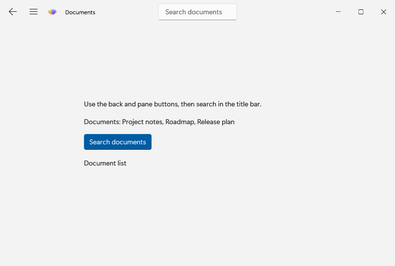
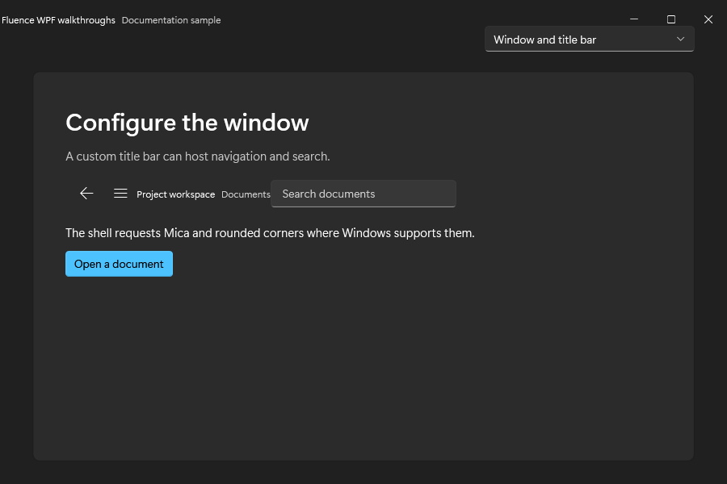

# Configure a window and title bar

This standalone window shows how to put controls in a `FluenceWindow` title bar and respond to its requests. It has a back button, a pane toggle button, and a search box in the chrome. Start with the [Basic walkthrough](../csharp/usage.md), then replace the window content and code-behind with the examples below. Replace `MyApp` with your project namespace.

## Declare the window

Set `ExtendsContentIntoTitleBar="True"` on the tutorial window and replace its content with these title-bar and content elements. The [standalone sample](https://github.com/sintaxasn/Fluence.Wpf.Website/blob/main/samples/Fluence.Wpf.Docs.Walkthroughs/WindowAndTitleBarWindow.xaml) contains the complete window.

~~~xml
<fluence:FluenceWindow.TitleBar>
    <fluence:TitleBar x:Name="ShellTitleBar" Title="Documents"
                      IsBackButtonVisible="True"
                      IsPaneToggleButtonVisible="True">
        <fluence:TitleBar.CustomContent>
            <fluence:TextBox x:Name="TitleSearch" Width="160" PlaceholderText="Search documents"
                             WindowChrome.IsHitTestVisibleInChrome="True" />
        </fluence:TitleBar.CustomContent>
    </fluence:TitleBar>
</fluence:FluenceWindow.TitleBar>
<fluence:StackPanel Width="460" HorizontalAlignment="Center" VerticalAlignment="Center" Spacing="16">
    <fluence:TextBlock Text="Use the back and pane buttons, then search in the title bar."
                       TextWrapping="Wrap" />
    <fluence:TextBlock x:Name="DocumentsPane" Text="Documents: Project notes, Roadmap, Release plan" />
    <fluence:Button Content="Search documents" Appearance="Accent"
                    Click="OpenDocument_Click" HorizontalAlignment="Left" />
    <fluence:TextBlock x:Name="DocumentStatus" Text="Document list" />
</fluence:StackPanel>
~~~

## Wire the interaction

[WindowAndTitleBarWindow.xaml.cs](https://github.com/sintaxasn/Fluence.Wpf.Website/blob/main/samples/Fluence.Wpf.Docs.Walkthroughs/WindowAndTitleBarWindow.xaml.cs) contains the code-behind. Replace `MainWindow.xaml.cs` with the following code and use the same namespace as your XAML.

~~~csharp
using System.Windows;
using Fluence.Wpf.Controls;
namespace MyApp
{
    public partial class MainWindow : FluenceWindow
    {
        public MainWindow()
        {
            InitializeComponent();
            ShellTitleBar.BackRequested += (sender, args) =>
            {
                DocumentsPane.Visibility = Visibility.Visible;
                DocumentStatus.Text = "Document list";
            };
            ShellTitleBar.PaneToggleRequested += (sender, args) =>
                DocumentsPane.Visibility = DocumentsPane.Visibility is Visibility.Visible
                    ? Visibility.Collapsed
                    : Visibility.Visible;
        }

        private void OpenDocument_Click(object sender, RoutedEventArgs e)
        {
            string query = TitleSearch.Text.Trim();
            DocumentStatus.Text = string.IsNullOrWhiteSpace(query)
                ? "Enter a search term in the title bar."
                : "Results for " + query;
            if (!string.IsNullOrWhiteSpace(query))
            {
                DocumentsPane.Visibility = Visibility.Collapsed;
            }
        }
    }
}
~~~

`TitleSearch` is placed in `TitleBar.CustomContent`. `WindowChrome.IsHitTestVisibleInChrome="True"` lets the text box receive input even though it sits in the draggable title area. `fluence:StackPanel` spaces the window content without margins on each child. The constructor handles `BackRequested` by returning to the document list and `PaneToggleRequested` by showing or hiding it. Selecting **Search documents** reads the search box and updates `DocumentStatus`; it does not open a file.

## See the result

The screenshots show the standalone sample, which uses the same controls with its own window shell.

See [FluenceWindow](../controls/fluence-window.md), [TitleBar](../controls/title-bar.md), and [Windows and backdrop support](../csharp/requirements.md#windows-and-backdrop-support).
