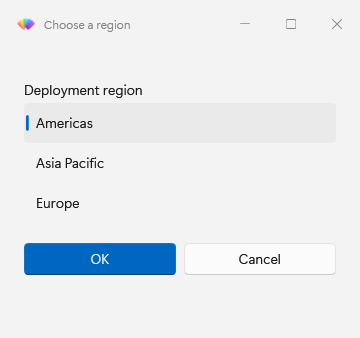
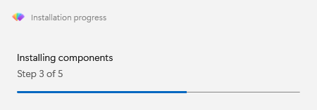
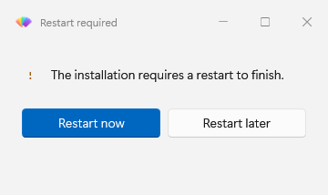
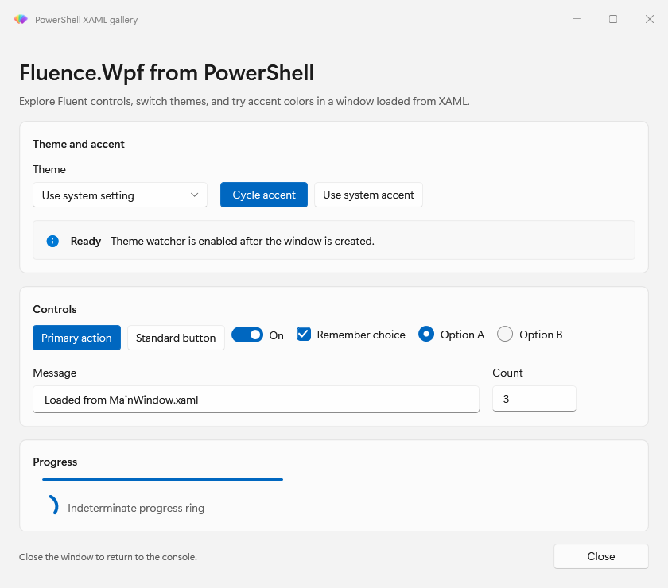

# PowerShell controls and dialogs

Choose the interface that gives your script the answer it needs. Images illustrate the type of interface; actual fields and options vary:

| Need | Start with |
| --- | --- |
| Show a message or ask Yes/No | [Show-FluenceMessage](reference/Show-FluenceMessage.mdx)  |
| Ask for one value | [Get-FluenceInput](reference/Get-FluenceInput.mdx) Illustrative form:  |
| Ask for one or more list items | [Show-FluenceListSelection](reference/Show-FluenceListSelection.mdx)  |
| Collect several validated values | [Show-FluenceDialog](reference/Show-FluenceDialog.mdx) and [New-FluencePrompt](reference/New-FluencePrompt.mdx)  |
| Report work in progress | [Show-FluenceProgress](reference/Show-FluenceProgress.mdx)  |
| Show a deployment restart choice | [Show-FluenceRestartPrompt](reference/Show-FluenceRestartPrompt.mdx)  |
| Build a custom interface | [Show-FluenceWindow](reference/Show-FluenceWindow.mdx)  |

The [input type reference](reference/input-types.md) lists prompt types, values, defaults, and validation behavior. The [result object reference](reference/result-objects.md) explains what commands return.

For examples, use the [dialogs](how-to/dialogs.md), [forms](how-to/forms-and-validation.md), [progress](how-to/progress.md), and [custom window](how-to/windows-from-xaml.md) walkthroughs. The [ControlsTour example](../../Fluence.Wpf.PowerShell.Module/examples/06-ControlsTour.ps1) shows the visual surface. Browse the [control catalog](../controls.md) when you need underlying C# controls for a custom window.
