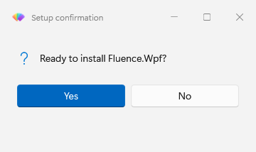
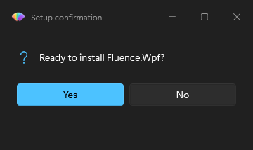
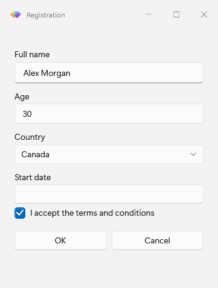
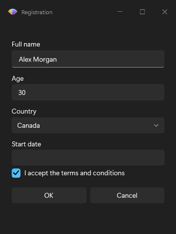

# PowerShell basic usage

This short example builds a deployment note prompt and reads the answer. Complete [installation](installation.md) first. You need an interactive Windows desktop.

## 1. Import the module

For an installed module:

```powershell
Import-Module Fluence.Wpf.PowerShell
```

From a staged repository checkout, import the manifest path shown in [installation](installation.md#source-checkout). You can check the available functions with `Get-Command -Module Fluence.Wpf.PowerShell`.

## 2. Show a message

```powershell
$answer = Show-FluenceMessage -Title 'Setup' -Message 'Create a deployment note?' -Icon Question -Buttons YesNo

if ($answer -ne 'Yes')
{
    return
}
```

The command returns the clicked button name, such as `Yes` or `No`. Closing a Yes/No message with Esc or the title bar returns `No`.





## 3. Ask for validated values

```powershell
$prompts = @(
    New-FluencePrompt -Name Application -Message 'Application name' -ValidateNotEmpty
    New-FluencePrompt -Name Owner -Message 'Deployment owner' -DefaultValue 'IT'
)

$result = Show-FluenceDialog -Title 'Deployment note' -Message 'What are you deploying?' -Prompts $prompts -Buttons 'Save', 'Cancel'

if ($result.Save)
{
    "Deployment note: $($result.Application), owner $($result.Owner)"
}
```

Clear the application name and choose Save to see validation keep the dialog open. The result has a property for each named prompt and a Boolean flag for each button, plus `Cancelled` and `TimedOut`. Check the button flag before using input values.

The following images show the form layout with example values.





## 4. Put it in a script

Save the import and the two examples above, in order, as `DeploymentNote.ps1`. Run the script from a PowerShell console after installing the module. The example displays and reads values; it does not deploy an application.

Use the [forms walkthrough](how-to/forms-and-validation.md) for other input types and validation rules, or the [Functions Reference](reference/README.md) for parameters and return values.
