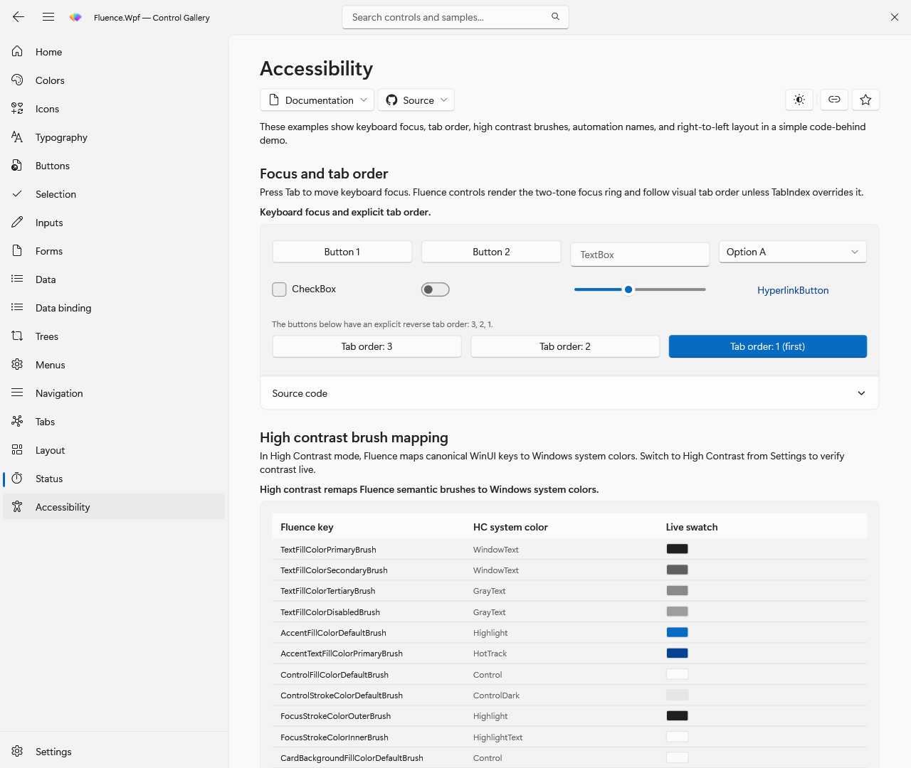
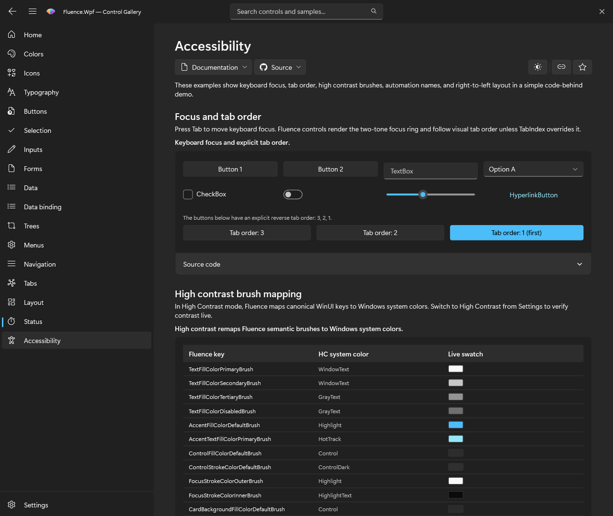

# Accessibility

Fluence.Wpf controls follow WPF keyboard, focus, and UI Automation patterns where their base control supplies them. Custom controls add peers in `Fluence.Wpf.Automation` for their own behavior. The Gallery's Accessibility page exercises focus order, high contrast, automation, and right-to-left layout.





## Provide names and keyboard paths

Use this checklist when building an application:

- Give icon-only and otherwise unlabeled controls an accessible name with `AutomationProperties.Name`. Check that the name describes the action rather than the icon.
- Check the Tab order and complete each task using a keyboard. Include custom content in title bars, navigation panes, dialogs, and flyouts.
- Keep a visible focus indicator. Application templates should use the published focus resources.
- Check Light, Dark, and High Contrast for readable text, status, focus, and selection. Do not convey status through color alone.
- Check reduced-motion behavior for application animations, and exercise the UI with a screen reader on the Windows versions you support.

For example, give an icon-only button a name:

```xml
<fluence:Button AutomationProperties.Name="Refresh">
    <fluence:Button.Icon>
        <fluence:FontIcon Glyph="&#xE72C;" />
    </fluence:Button.Icon>
</fluence:Button>
```

## Check custom controls

The following custom peers are defined in [`Fluence.Wpf.Automation`](https://github.com/sintaxasn/Fluence.Wpf/tree/main/Fluence.Wpf/Automation). The peer is created by its owning control; inherited WPF automation behavior may also apply. Consult the peer and its XML comments for its exact provider and pattern behavior.

| Control | Custom automation peer |
| --- | --- |
| `AutoSuggestBox` | `AutoSuggestBoxAutomationPeer` |
| `BreadcrumbBar` | `BreadcrumbBarAutomationPeer` |
| `Card` | `CardAutomationPeer` |
| `ColorPicker` | `ColorPickerAutomationPeer` |
| `ContentDialog` | `ContentDialogAutomationPeer` |
| `DatePicker` | `DatePickerAutomationPeer` |
| `DropDownButton` | `DropDownButtonAutomationPeer` |
| `FlyoutPresenter` | `FlyoutPresenterAutomationPeer` |
| `FontIcon` | `FontIconAutomationPeer` |
| `HyperlinkButton` | `HyperlinkButtonAutomationPeer` |
| `Image` | `ImageAutomationPeer` |
| `InfoBadge` | `InfoBadgeAutomationPeer` |
| `InfoBar` | `InfoBarAutomationPeer` |
| `NavigationView` | `NavigationViewAutomationPeer` |
| `NavigationViewItem` | `NavigationViewItemAutomationPeer` |
| `NumberBox` | `NumberBoxAutomationPeer` |
| `PersonPicture` | `PersonPictureAutomationPeer` |
| `PipsPager` | `PipsPagerAutomationPeer` |
| `ProgressRing` | `ProgressRingAutomationPeer` |
| `RatingControl` | `RatingControlAutomationPeer` |
| `SelectorBarItem` | `SelectorBarItemAutomationPeer` |
| `SplitButton` | `SplitButtonAutomationPeer` |
| `TeachingTip` | `TeachingTipAutomationPeer` |
| `TextBlock` | `TextBlockAutomationPeer` |
| `TimePicker` | `TimePickerAutomationPeer` |
| `TitleBar` | `TitleBarAutomationPeer` |
| `ToggleSplitButton` | `ToggleSplitButtonAutomationPeer` |
| `ToggleSwitch` | `ToggleSwitchAutomationPeer` |

The [automation peer tests](../../Fluence.Wpf.Tests/Control/Rules/AutomationPeerTests.cs) and [accessible name tests](../../Fluence.Wpf.Tests/Control/Rules/AccessibilityNameTests.cs) are executable checks.

## Test appearance as well as events

The theme engine republishes High Contrast brushes from Windows system colors. Verify your own controls and overrides in each theme as well as with keyboard navigation and a screen reader. The [Gallery](../../Fluence.Wpf.Demo/README.md) provides a visual starting point.
